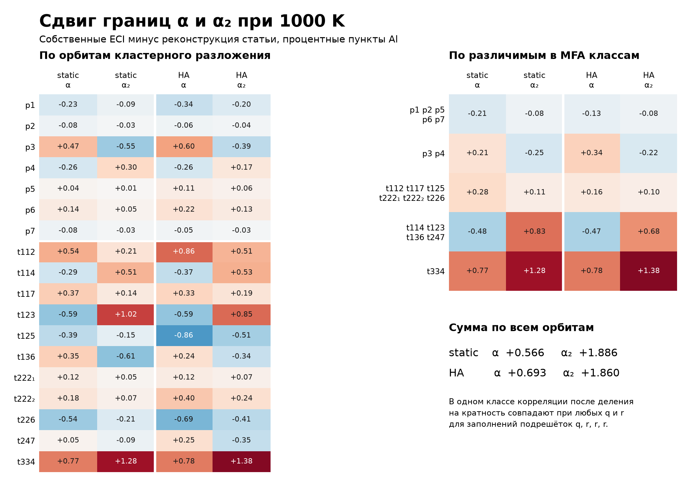

# Почему сдвинулись границы MFA Ti–Al при 1000 K

При переходе от опубликованных ECI к собственной подгонке граница α₂ сдвигается вправо на **1.886 процентного пункта Al** в статической модели и на **1.860** при учёте гармонических колебаний (HA). В обоих случаях наибольший положительный вклад даёт тройка **t334**. При прямой замене t334 и t123 вместе на фоне статьи получаются сдвиги α₂ **+2.155** и **+2.174** пункта. Остальные замены в сумме частично компенсируют этот эффект. Граница α смещается на **+0.566** и **+0.693** пункта. Здесь несколько крупных вкладов имеют разные знаки.

## Исходные данные и проверка границ

Температура 1000 K, объём 17.28832985 ų/атом. Заполнения четырёх подрешёток Al равны q, r, r, r, состав c = (q + 3r)/4 и параметр порядка m = q − r. В упорядоченной ветви выбирается богатая Al подрешётка. На стороне статьи взяты округлённые статические ECI из S1 и 18 колебательных поправок, считанных с рисунка 2 при 1000 K. На стороне независимого расчёта взяты статические и колебательные ECI из одной подгонки на 37 обучающих структурах ATAT с одной маской фононной устойчивости. Семь структур оставлены для контроля, train_26 и train_30 исключены из обучения. Постоянный и точечный члены при фиксированном объёме задают аффинное по составу слагаемое и сокращаются в расчёте составов контакта. [Коэффициенты статьи](../../thermo/results/coefficients_HA1000.json) · [Собственные ECI](../../atomistic/atat/ha_fit/grid.npz) · [Маска и валидация](../../atomistic/atat/ha_fit/validation.json)

| Статические ECI | Колебательные ECI | α, ат.% Al | α₂, ат.% Al | m в α₂ |
|---|---|---:|---:|---:|
| S1 | 0 | 6.19226 | 20.70766 | 0.82726 |
| Собственные | 0 | 6.75816 | 22.59322 | 0.90290 |
| S1 | Рис. 2 | 8.96057 | 19.21940 | 0.75578 |
| Собственные | Рис. 2 | 9.94139 | 21.82948 | 0.86266 |
| S1 | Собственные | 8.62710 | 18.29029 | 0.71760 |
| Собственные | Собственные | 9.65308 | 21.07908 | 0.83234 |

Все восемь границ четырёх исходных гамильтонианов совпали с предыдущим независимым решением через выпуклую оболочку в пределах 4.2 × 10⁻⁸ процентного пункта. В таблице 1 самой статьи напечатаны 6.16/20.80 и 8.93/19.42. Различие собственной α₂ с напечатанной составляет +1.793 и +1.659 пункта, соответственно. Из него отдельно выделяется расхождение между округлённой/оцифрованной реконструкцией и напечатанной величиной. Масштаб одного пикселя по оси рисунка 2 составляет 0.14545 мэВ для пар и 0.03298 мэВ для троек. [Результаты с проверками](results/checks.json) · [Все шесть изотерм в точках касания](results/states.csv)

## Какие взаимодействия определяют сдвиг



| Вклад, процентные пункты Al | static α | static α₂ | HA α | HA α₂ |
|---|---:|---:|---:|---:|
| Все семь пар | −0.002 | −0.329 | +0.218 | −0.298 |
| Все одиннадцать троек | +0.568 | +2.215 | +0.474 | +2.157 |
| В том числе t334 | +0.769 | +1.275 | +0.784 | +1.380 |
| В том числе t123 | −0.587 | +1.020 | −0.588 | +0.850 |

Для границы α в HA почти равные по модулю слагаемые t125 (−0.861) и t112 (+0.859) компенсируются. В статике на α₂ заметны встречные вклады t136 (−0.613) и p3 (−0.549). Среди семи пар есть и заметные отдельные изменения, хотя их суммарный вклад невелик. Например, в статике на α p3 даёт +0.468, p4 −0.257, p1 −0.227. [Все 18 орбит и оба направления точной замены](results/orbit_attribution.csv) · [Суммы пар и троек](results/pair_triplet_sums.csv)

В этой версии MFA 18 орбит образуют **пять** классов с одинаковыми корреляционными полиномами после деления на кратность. Внутри класса модель чувствительна только к сумме ECI с кратностями. Класс t114, t123, t136, t247 в совокупности даёт +0.832 (static) и +0.681 (HA) на α₂. Класс t112, t117, t125, t222₁, t222₂, t226 даёт +0.108 и +0.096. Два парных класса дают отрицательные суммарные вклады в α₂. T334 образует собственный класс. Индивидуальные числа применимы к данным наборам ECI и базису S1. Равносильное перераспределение ECI внутри класса оставляет поверхность MFA неизменной. [Пять классов и изменения ECI с кратностями](results/mfa_orbit_classes.csv)

### Статический и колебательный вклад в HA

Если сначала заменить статические ECI, сдвиг на фоне колебаний статьи равен (+0.981, +2.610) для (α, α₂). Если сначала заменить колебательные ECI, сдвиг от последующей статической замены составляет (+1.026, +2.789). Собственные колебательные поправки сдвигают границы влево как на фоне статики статьи (−0.333, −0.929), так и на фоне собственной статики (−0.288, −0.750). При усреднении двух порядков замены статическая часть даёт **(+1.003, +2.699)**, колебательная **(−0.311, −0.840)**. Совместный нелинейный эффект двух групп равен (+0.045, +0.179).

На одновременном прямолинейном пути от статьи к собственной модели разделение по производным даёт (+1.005, +2.752) от статики и (−0.313, −0.892) от колебаний. В частности, на α₂ статическая замена t334 даёт +2.046, колебательная −0.665 пункта. Оба способа разложения точно воспроизводят итоговый сдвиг. Групповые числа зависят от способа распределения нелинейного взаимодействия. [Точные перекрёстные замены](results/checks.json) · [Прямолинейный путь](results/orbit_attribution.csv)

### Доля, связанная с упорядочением

Для каждой орбиты выделена корреляция при случайном заполнении того же состава, Φᵢʳ(c) = Mᵢ(2c−1)ᵈ, где Mᵢ — кратность на атом и d равно 2 или 3. Остаток Φᵢ(c,m) − Φᵢʳ(c) зависит от подрешёточного порядка. Обе части перенесены через одну и ту же восприимчивость общей касательной равновесных фаз.

| Часть сдвига, процентные пункты Al | static α | static α₂ | HA α | HA α₂ |
|---|---:|---:|---:|---:|
| Корреляции случайного заполнения | +0.046 | −0.168 | +0.020 | −0.074 |
| Добавка от подрешёточного порядка | +0.520 | +2.053 | +0.673 | +1.934 |

Для t334 статическое ΔJ равно −1.737 мэВ, а колебательное ΔJ при 1000 K равно +0.565 мэВ. В исходном составе контакта α₂ замена t334 повышает разность энергий между упорядоченным и случайным заполнениями на +2.488 мэВ/атом (static) или +1.644 мэВ/атом (HA). Замена t123 при том же определении понижает её на −1.354 или −0.915 мэВ/атом. Тем не менее обе замены сдвигают α₂ вправо. Для определения сдвига важны и наклоны свободных энергий в обоих контактах. [Вклады орбит в энергию упорядочения и состав контактов](results/orbit_attribution.csv)

## Численный метод и устойчивость вывода

Для каждого набора ECI нашли общую касательную между разупорядоченной ветвью m = 0 и упорядоченной ветвью с равновесным m. При c ∈ [0, 0.35] на 701 составе проверили, что линия лежит ниже минимальной свободной энергии с допуском 2 × 10⁻⁸ эВ/атом. Каждый контакт дополнительно проверен по минимуму по q и положительности кривизн. Для прямого пути коэффициенты меняются как J(λ) = J₀ + λ(J₁ − J₀). На каждом λ чувствительности вычисляются по неявным производным условий касания:

* dμ/dJᵢ = [Φᵢ(α₂) − Φᵢ(α)]/(c₂ − c₁).
* dc/dJᵢ = [dμ/dJᵢ − dΦᵢ/dc]/f″ в соответствующей фазе. Здесь dΦᵢ/dc включает отклик m′ = −f𝚌ₘ/fₘₘ, а f″ = f𝚌𝚌 − f𝚌ₘ²/fₘₘ.
* Вклад орбиты равен 100 ΔJᵢ ∫₀¹ (dc/dJᵢ)dλ. Между квадратурами Гаусса порядка 8 и 16 наибольшее изменение отдельного вклада составило 5.6 × 10⁻¹³ процентного пункта. Невязка суммы с полным пересчётом меньше 8 × 10⁻¹³ пункта. В середине обоих путей все 72 производные по 18 орбитам проверены центральной разностью с шагом 10⁻⁷ эВ. Максимальная относительная разница 1.8 × 10⁻⁸. [Проверка производных](results/finite_differences.csv)

Для каждой из 18 орбит выполнена точная подстановка на обоих фонах. При ранжировании абсолютных величин корреляция Спирмена с интегральными вкладами лежит между 0.992 и 1.000. Для α₂ во всех вариантах первые две орбиты — t334 и t123. Для α в HA соседние места меняются между t112, t125 и t334. [Ранги и зависимость от фона](results/swap_rank_checks.csv)

Дополнительно рассчитаны все 153 пары **замен ECI** на обоих фонах для static и HA, итого 612 гамильтонианов. Для каждой пары вычислена поправка c(i,j) − c(i) − c(j) + c(0). По модулю наибольшая поправка на α₂ у пары замен t123 и t334 на всех четырёх фонах. При прямой замене она равна −0.418 пункта (static) и −0.227 (HA), при обратной −0.464 и −0.203. Например, в статике прямые индивидуальные сдвиги +1.408 и +1.164 пункта дают совместный +2.155 после учёта этой поправки. Семь парных орбит, заменённые одновременно на фоне статьи, дают α₂ −0.469 static или −0.332 HA. Числа в таблице интегральных вкладов учитывают изменение фона по всему пути. [Все парные замены](results/two_orbit_swaps.csv)

Для десяти гамильтонианов проверки Монте-Карло получены составы MFA на тех же 18 неаффинных ECI. Сверка проведена непосредственно с файлами, подготовленными для MC. Наибольшее расхождение ECI равно нулю. После совместной прямой замены t123 и t334 границы MFA равны 6.3580/22.8629 для static и 9.1368/21.3936 для HA. После обратной замены получаются 6.5571/20.1372 и 9.4346/18.8226. Все выводы о величине и ранге эффектов в этой записке относятся к четырёхподрешёточному MFA при заданных ECI. Результаты MC требуют отдельного сравнения. [Десять точно сопоставленных гамильтонианов](results/mc_hybrid_mfa.csv)

## Воспроизведение

Из корня рабочего проекта, в Python с NumPy, SciPy и Matplotlib:

```powershell
python phase_reproduction/eci_boundary/mfa/attribute.py
python phase_reproduction/eci_boundary/mfa/cross_checks.py
python phase_reproduction/eci_boundary/mfa/plot.py
```

На текущем Windows-хосте использованы комплектный Python Codex и уже установленная научная среда во временном каталоге. Эквивалентный запуск:

```powershell
$analysisPython = 'C:/Users/Roman Ryltsev/.cache/codex-runtimes/codex-primary-runtime/dependencies/python/python.exe'
$env:V16_PYLIB = Join-Path $env:TEMP 'tial-phase-v16-analysis-deps'
$analysisLauncher = "import os,sys,runpy;sys.path.insert(0,os.environ['V16_PYLIB']);sys.argv=sys.argv[1:];runpy.run_path(sys.argv[0],run_name='__main__')"
& $analysisPython -c $analysisLauncher phase_reproduction/eci_boundary/mfa/attribute.py
& $analysisPython -c $analysisLauncher phase_reproduction/eci_boundary/mfa/cross_checks.py
& $analysisPython -c $analysisLauncher phase_reproduction/eci_boundary/mfa/plot.py
```

Поле `mu_eV_affine_gauge` задаёт наклон после удаления константы и точечного члена. В таблице `orbit_attribution.csv` обе колонки одиночной замены приведены к направлению «статья → собственные ECI». В `two_orbit_swaps.csv` обе одиночные и двойная замены отсчитываются от фона, указанного в `base`.
