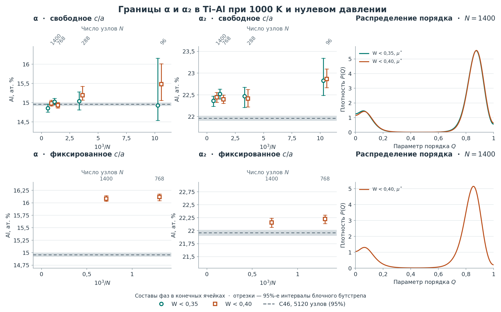

# Равновесие α/α₂ в Ti–Al при 1000 K и нулевом давлении

Для опубликованного MTP Qi прямой расчёт дал **14,98 ат.% Al в α и 22,44 ат.% Al в α₂**. Это средние по двум фазовым областям в наибольшей ячейке, 1400 атомов, при свободных объёме и c/a и ограничении смещений W<0,40. Условные 95%-е статистические интервалы по коррелированным блокам составляют **14,92–15,06** и **22,33–22,55 ат.%**. При этом поле сосуществования в конфигурационной нормировке равно 3,29368 эВ на замену Ti→Al. Давление задано внешним баростатическим весом. Объёмы фаз равны 17,457 и 17,241 ų/атом, а равновесные c/a — 1,5915 и 1,6064. Все серии проведены на UMT под `u3129`. [Расчёт при N=1400](analysis1400_free.json) · [Потенциал Qi и соавт.](https://doi.org/10.1103/PhysRevMaterials.7.103602)

## Размер ячейки и амплитуда смещений

| Атомов | α, W<0,35 | α₂, W<0,35 | α, W<0,40 | α₂, W<0,40 |
|---:|---:|---:|---:|---:|
| 96 | 14,93 | 22,83 | 15,48 | 22,86 |
| 288 | 15,04 | 22,47 | 15,19 | 22,42 |
| 768 | 15,02 | 22,52 | 14,93 | 22,40 |
| 1400 | 14,86 | 22,36 | 14,98 | 22,44 |

Все составы приведены в ат.% Al. W — максимальная доля расстояния от идеального узла до грани ячейки Вигнера–Зейтца, вычисленная по всем атомам после удаления общего переноса. При W<0,40 увеличение ячейки с 768 до 1400 атомов сдвинуло обе оценки на +0,05 процентного пункта. При W<0,35 сдвиги составили −0,17 и −0,16 п.п. В ячейке на 1400 атомов расширение допустимой области с 0,35 до 0,40 повысило оценки на 0,12 и 0,08 п.п. Десятые доли ат.% служат разумным масштабом разрешения этого расчёта. Цифры в таблице позволяют проследить изменения между сериями. [96 атомов](pilot96.json) · [288 атомов](pilot288.json) · [768 атомов](analysis768_free.json) · [1400 атомов](analysis1400_free.json)

Для W<0,40 барьер на профиле химического порядка при равных высотах максимумов вырос примерно с 2,2 kBT на 288 атомах до 4,2 kBT на 768 и 5,7 kBT на 1400. На 1400 атомах два независимых набора окон дали для α 14,89 и 15,08 ат.%, для α₂ — 22,37 и 22,53 ат.%. Изменение границы между фазовыми областями от Q=0,34 до 0,54 сдвигает составы максимум на 0,02 п.п. Четвёртая кумулянта распределения состава, без деления по Q, даёт ширину интервала сосуществования 7,46 п.п. против 7,46 п.п. по средним двух фаз. [Проверки по распределению состава и структуре](phase_checks.json)

При более жёстком ограничении α теряет больше конфигураций со значительными тепловыми смещениями. На 288 атомах при W<0,40 в более тесную область W<0,35 попали 15,8% конфигураций α и 46,8% конфигураций α₂ по равновесным весам. Перевзвешивание в тесную область дало 15,05 и 22,34 ат.%, что согласуется с независимым прямым расчётом при W<0,35. На 1400 атомах такие конфигурации редки, поэтому чувствительность там оценена по двум самостоятельным сериям. Ранее для этого MTP были обнаружены нефизически низкие энергии при сильном сближении атомов. Приведённое равновесие относится к конденсированному ГПУ-бассейну с указанными ограничениями. [Проверка вложенных областей](nested288.json) · [Проверка потенциала при сближении атомов](../alloy_ti/README.md)

## Независимая проверка составов

В отдельной проверке мы убрали смещающее поле по химическому порядку, задав разность химических потенциалов вблизи значения MBAR. Для каждого из двух значений предела W использованы по четыре случайных и по четыре упорядоченных начальных состояния на 1400 атомах. Условные средние внутри фаз при W<0,40 составили **14,987 и 22,489 ат.% Al**. Разности с основным результатом равны +0,005 и +0,044 п.п. При W<0,35 отдельные траектории дали 14,914 и 22,486 ат.%. Два из четырёх первоначально упорядоченных состояний при W<0,35 перешли в α во время релаксации. Число стартовых траекторий каждой фазы исключено из определения относительных фазовых весов. [Независимые траектории без ограничения химического порядка](endpoint_controls.json)

## Сопоставление с C46

Общая касательная C46 по 13 авторским окнам на 5120 узлах даёт **14,9581** и **21,9583 ат.% Al**. Относительно неё в прямом MTP со свободным c/a граница α сместилась на **+0,02 п.п.**, граница α₂ — на **+0,49 п.п.** C46 использует фиксированное c/a = 1,56374 и квантовые квазигармонические колебания, а прямой MTP включает классические ангармонические смещения и химические замены. [Проверка авторской касательной и интервалы](c46_reference.json)

| Геометрия и метод | α, ат.% Al | α₂, ат.% Al |
|---|---:|---:|
| Прямой MTP, свободное c/a, N=1400, W<0,40 | 14,982 | 22,445 |
| Прямой MTP, фиксированное c/a, N=768, W<0,40 | 16,118 | 22,224 |
| Прямой MTP, фиксированное c/a, N=1400, W<0,40 | 16,083 | 22,159 |
| C46, фиксированное c/a, N=5120 | 14,958 | 21,958 |

При одинаковом фиксированном c/a прямой MTP даёт **на 1,12 п.п. больше Al в α и на 0,20 п.п. больше в α₂**, чем C46. Снятие ограничения на c/a в прямом расчёте уменьшает состав α на 1,10 п.п. и повышает состав α₂ на 0,29 п.п. Поэтому близость значения C46 к полностью релаксированной границе α возникает при компенсации двух сдвигов. Первая разность характеризует совокупное действие кластерной аппроксимации, описания колебаний и статистики ядер. Для оценки ошибки потенциала относительно электронной структуры нужен отдельный референс. [Контроль при 768 атомах](analysis768_fixed.json) · [Контроль при 1400 атомах](analysis1400_fixed.json)

При фиксированном c/a условные 95%-е интервалы в наибольшей ячейке составляют 16,03–16,14 ат.% для α и 22,06–22,24 ат.% для α₂. Отдельный анализ только окон, запущенных вблизи собственного поля сосуществования этой ячейки, даёт 16,091 и 22,169 ат.%. Ширина двухфазной области составляет 6,08 п.п. при фиксированном c/a, 7,46 п.п. при свободном c/a и 7,00 п.п. в C46. 95%-й статистический интервал увеличения ширины при снятии ограничения на оси равен 1,22–1,54 п.п. [Сводная статистика](summary_statistics.json)



## Воспроизведение

Завершены 26 серий Slurm, включающих 284 траектории и 266 400 производственных проходов Монте-Карло. Параметры и случайные семена каждого окна лежат в `series/<имя>/windows.csv`. Рядом доступны полные ряды, состояния и статус каждого процесса. В `../cluster/runs/<имя>/` записаны номер Slurm, контрольные суммы входов и проверенный архив вывода. Программа `sgmc.cpp` выполняет шаги Монте-Карло и в конце каждого окна проверяет накопленную энергию полным пересчётом. Сценарий запуска сверяет SHA-256 MTP. Веса окон и статистические интервалы восстанавливает `analysis.py`. Следующая команда повторяет основной анализ для 1400 атомов из каталога `solvus_1000` в окружении Python с NumPy и SciPy. [Реестр серий и SHA-256](run_provenance.json) · [Сводная статистика и разности между расчётами](summary_statistics.json)

```console
python analysis.py series/s1400w35a/windows.csv series/s1400w35b/windows.csv series/s1400w40a/windows.csv series/s1400w40b/windows.csv --bootstrap 192 --output replay1400.json
```

[Вывод ансамблевых весов и критериев равновесия](method_ru.md) · [Исходный код Монте-Карло](sgmc.cpp) · [Статистический анализ](analysis.py) · [Независимая проверка энергий по MLIP3](../cluster/runs/engine-sgc-check-02/outputs/engine_report.json)
