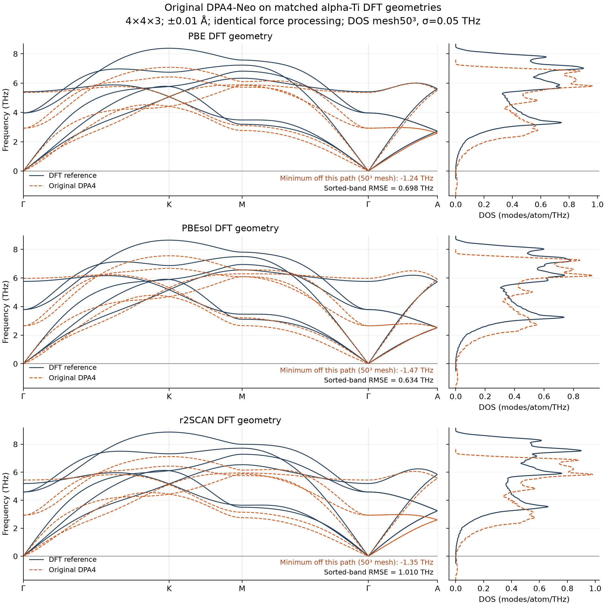

# Фононы исходной DPA4: H0

Использован исходный DPA4-Neo-OMat24-v20260805 с SHA256 `fd7f34ae28f921201e4a0328ddf56179892752084f8363e7796038201471c989`. Каждому функционалу соответствует его собственная фиксированная DFT-ячейка; геометрии не релаксировались моделью. Job20988449 завершён за 52 с. Новых DFT: 0.

DFT-спектры воспроизведены из сохранённых сил с максимальной разницей менее 2.6×10⁻⁷ ТГц относительно архивного Figure2. Одинаковы supercell4×4×3, ±0.01Å, масса 47.867, central-pair/mean-drift, symfc и ASR, DOS mesh50³ и σ0.05 ТГц. Интеграл DOS =3 моды/атом. Исходные силы и raw/central/ASR силовые константы сохранены отдельно.

| Reference cell | Γ doublet DFT / FM, THz | Γ singlet DFT / FM, THz | Sorted spectral RMSE, THz | Mesh minimum FM, THz |
|---|---:|---:|---:|---:|
| PBE | 3.964 / 2.927 | 5.408 / 5.365 | 0.698 | -1.239 |
| PBEsol | 3.786 / 2.651 | 5.758 / 5.972 | 0.634 | -1.466 |
| r2SCAN | 4.587 / 2.930 | 5.189 / 5.439 | 1.010 | -1.346 |

Исходная FM имеет мнимые ветви на всех трёх фиксированных DFT-геометриях; обработанный DFT-reference их не имеет на данной сетке. Численная воспроизводимость H0 пройдена, но это не означает физическую точность исходной модели. Малый остаток ASR сам по себе не устраняет неустойчивость.

Отдельный job20988452 проверил raw, central и ASR силовые константы. Большие отрицательные частоты FM сохраняются на всех стадиях практически без изменения: обработка их не создала. Минимум находится около H, q=[0.34, 0.32,-0.5], вне показанного архивного пути Γ–K–M–Γ–A. Малые raw DFT остатки порядка 0.004 ТГц около Γ сохранены в diagnostics; после central-pair/ASR они исчезают.

Для r²SCAN исходный optical c-singlet5.439 ТГц близок к DFT5.189 ТГц, но doublet2.930 ТГц заметно ниже DFT4.587 ТГц. Архивный адаптированный checkpoint имел singlet около 4.221 ТГц и меньшую общую spectral RMSE около 0.259 ТГц. Следовательно, адаптация могла улучшить спектр в целом, ухудшив эту конкретную моду. Старый checkpoint не является независимым baseline нового train/test-разбиения; это только согласованная физическая диагностика.

В `mode_diagnostics.json` отдельно сохранены максимальное overlap-сопоставление собственных векторов при каждом q, projectors для вырожденных подпространств, различия динамических матриц и акустические фазовые скорости на четырёх малых q. Sorted RMSE не выдаётся за ошибку конкретной отслеживаемой ветви. Сходимость по малому q при фиксированных FC не устанавливает сходимость по supercell, cutoff и электронной k-сетке.

Фононы, используемые при выборе настройки пилота, относятся к physical development benchmark. Проверки нового test149 и физического benchmark имеют разные роли.

