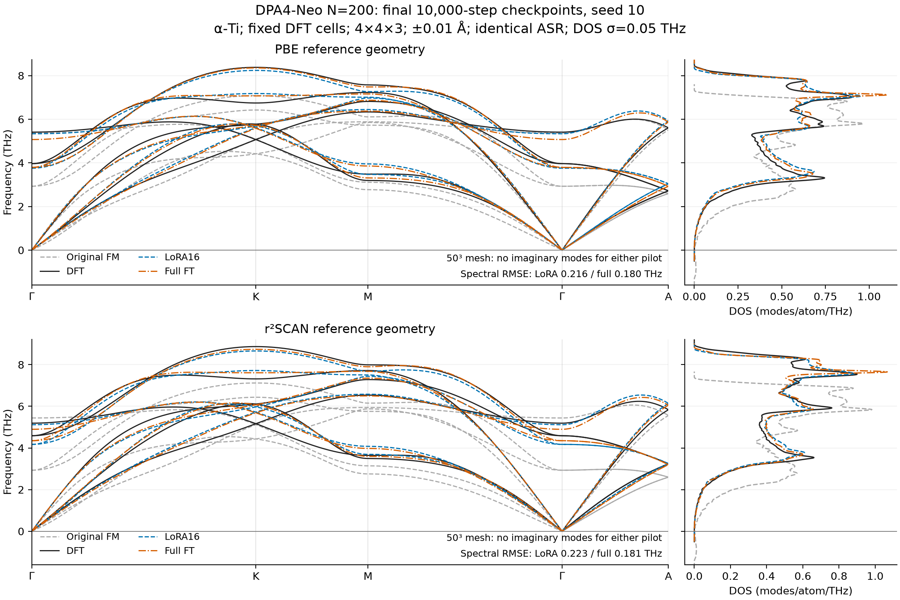

# DPA4 N=200: завершённый пилот LoRA16 и full FT

Все четыре запуска завершены: Slurm array **20988454_0–3**, по **10 000 шагов**, 50 nominal epochs, seed 10. Финальный checkpoint задан заранее; выбора лучшего по validation не было. Все четыре задачи метрик 20988460 и численного QC 20988469 завершены с exit 0. Дополнительная постобработка сохранённых FC (20988553) заняла 29 CPU-секунд. Новых DFT: **0**.

Собраны 687 файлов исходного результата с проверкой SHA256, включая четыре финальных merged checkpoint, train/validation-предсказания, силовые константы, спектры, DOS, журналы и конфигурации. Результаты дополнены диагностикой собственных векторов и акустических наклонов. Локальный повторный расчёт всех метрик воспроизводит кластерный в пределах rtol=1e-11, atol=1e-12.

## Сопоставимость и проверки

Одна исходная DPA4-Neo-OMat24-v20260805, SHA256 `fd7f34ae28f921201e4a0328ddf56179892752084f8363e7796038201471c989`. Единый split 694/149/149; N200 и validation149 имеют одинаковые ID у всех четырёх кандидатов. Пересечений их консервативных групп нет. Все 10 000 записей порядка optimizer batches совпадают побайтно; каждый запуск получил 10 000 frame exposures и 2 201 898 atom exposures. Метки нового test149 не использованы в сравнении, настройке или выборе checkpoint. Старый benchmark49 остаётся архивным.

Группы заданы точным числом Ti/Al, совместно для всех исходных семейств. Исходные жидкостные траектории утрачены; независимость условна относительно задокументированного MD+relaxation с сохранением состава. Это более грубая группировка, чем реальные родительские траектории, и одновременно проверка переноса между составами.

Пройдены zero-step, проверки маски, неизменности замороженных весов, live/merged на всех десяти checkpoint, native/export и финальные E/F, E/strain–virial, permutation/PBC/rotation QC. PASS означает численную корректность, а не доказанную физическую точность или MD-устойчивость.

## Validation: 149 структур, 23 группы

Ниже RMSE. Энергии считаются на атом с одинаковым весом структуры. E aligned использует только два элементных сдвига, найденных на N200 train отдельно для каждой модели. Силы объединены по атомам и компонентам; напряжения — по шести симметричным компонентам, σ=−sym(V)/Ω. Это не stochastic mini-batch MAE из training log.

| XC | Модель | E raw, meV/atom | E aligned, meV/atom | F, eV/Å | σ, GPa |
|---|---|---:|---:|---:|---:|
| PBE | Исходная FM | 2.940 | 2.034 | 0.07250 | 0.08871 |
| PBE | LoRA16 | 1.768 | 0.956 | 0.06602 | 0.07012 |
| PBE | Full FT | 1.773 | 1.137 | 0.06772 | 0.06647 |
| r2SCAN | Исходная FM | 4166.713 | 20.742 | 0.09740 | 0.91589 |
| r2SCAN | LoRA16 | 1.682 | 1.072 | 0.07568 | 0.08033 |
| r2SCAN | Full FT | 2.433 | 1.331 | 0.07755 | 0.07125 |

LoRA имеет меньшие validation RMSE энергии после выравнивания и сил для обоих функционалов. Преимущество по силовой RMSE относительно full FT составляет 2,52% для PBE и 2,41% для r²SCAN. Full FT имеет меньшие точечные ошибки напряжений. Все четыре кандидата улучшают эти три метрики относительно исходной FM. Большая raw-ошибка исходной FM относительно r²SCAN включает элементный энергетический сдвиг; сравнение по aligned E отделяет его от остаточной ошибки.

Парный bootstrap: 2000 повторов, одинаковые 23 консервативные группы resampled для обеих моделей. Δ=RMSE(LoRA)−RMSE(full); отрицательное значение благоприятно для LoRA. Сдвиги энергий фиксированы по train. Интервалы условны для seed 10 и этих данных; они не оценивают разброс обучения между seeds.

| XC | Метрика | Δ | 95% интервал Δ |
|---|---|---:|---:|
| PBE | E aligned, meV/atom | -0.180287 | [-0.260992; -0.063402] |
| PBE | F, eV/Å | -0.001705 | [-0.002149; -0.001158] |
| PBE | σ, GPa | +0.003651 | [-0.001166; +0.007420] |
| r2SCAN | E aligned, meV/atom | -0.259495 | [-0.357328; -0.181887] |
| r2SCAN | F, eV/Å | -0.001872 | [-0.002400; -0.001191] |
| r2SCAN | σ, GPa | +0.009081 | [+0.004600; +0.012440] |

Для энергии и сил интервалы не пересекают ноль. Для напряжений PBE интервал включает ноль; преимущество full FT здесь пока неубедительно. Для r²SCAN интервал напряжений благоприятен для full FT.

Validation содержит 133 liquid/relaxation, 7 γ-TiAl, 7 β-Ti/bcc и только 2 α-Ti/hcp. Средняя метрика преимущественно характеризует жидкостный пул. По F RMSE LoRA лучше на liquid/relaxation, а full FT немного лучше на α/β-кристаллических поднаборах; выборки кристаллов малы.

| XC | Метод | Train E aligned, meV/atom | Train F, eV/Å | Validation F p95 / p99 / max, eV/Å |
|---|---|---:|---:|---:|
| PBE | LoRA16 | 0.887 | 0.05918 | 0.139 / 0.203 / 0.548 |
| PBE | Full FT | 0.811 | 0.04934 | 0.143 / 0.211 / 0.537 |
| r2SCAN | LoRA16 | 0.947 | 0.06762 | 0.159 / 0.232 / 0.624 |
| r2SCAN | Full FT | 0.958 | 0.05604 | 0.164 / 0.240 / 0.602 |

Full FT сильнее снижает train-ошибку сил, но имеет больший разрыв train–validation. LoRA улучшает p95/p99, хотя максимальная ошибка компоненты силы у неё немного выше. По одному seed это не устанавливает универсальное преимущество регуляризации.

## Фононы на одинаковых DFT-геометриях α-Ti

Для каждого XC использованы его фиксированная DFT-ячейка, supercell 4×4×3, смещения ±0.01 Å, масса Ti 47.867, одна обработка central-pair/mean-drift/symfc/ASR. ML-релаксация не выполнялась. Сравнение частотно упорядоченных ветвей относится к общему пути Γ–K–M–Γ–A (604 точки), а устойчивость дополнительно проверена на сетке 50³. DOS: σ=0.05 THz, интеграл 3 моды/атом.

| XC | Модель | Spectral sorted RMSE, THz | Overlap-matched RMSE, THz | Γ doublet, THz | Γ c-singlet, THz | Мнимые моды на 50³ |
|---|---|---:|---:|---:|---:|---:|
| PBE | DFT | — | — | 3.964 | 5.408 | 0 |
| PBE | Исходная FM | 0.698 | 0.735 | 2.927 | 5.365 | 2028 |
| PBE | LoRA16 | 0.216 | 0.224 | 3.757 | 5.334 | 0 |
| PBE | Full FT | 0.180 | 0.186 | 3.792 | 5.069 | 0 |
| r2SCAN | DFT | — | — | 4.587 | 5.189 | 0 |
| r2SCAN | Исходная FM | 1.010 | 1.062 | 2.930 | 5.439 | 2616 |
| r2SCAN | LoRA16 | 0.223 | 0.233 | 4.171 | 5.115 | 0 |
| r2SCAN | Full FT | 0.181 | 0.187 | 4.347 | 4.896 | 0 |

У обеих адаптаций отсутствуют частоты ниже −0.001 THz на проверенной mesh50³, причём уже до central/ASR. Остатки порядка 10⁻⁷ THz — численный ноль. У исходной FM минимум −1.239 THz для PBE и −1.346 THz для r²SCAN, около H вне показанного пути. Отсутствие мнимых мод на этой сетке не является отдельной проверкой конечной температуры или долговременной MD.

Full FT точнее по общей spectral RMSE, overlap-сопоставлению и Γ-doublet. LoRA точнее по Γ c-singlet: ошибки −0.075 THz для обоих XC против −0.339 THz (PBE) и −0.293 THz (r²SCAN) у full FT. Относительно исходной FM full FT ухудшает этот синглет, одновременно улучшая спектр в целом. У PBE исходный синглет ближе к DFT, чем у обеих адаптаций; у r²SCAN LoRA улучшает синглет относительно исходной FM. Это локальный конфликт метрик, а не доказательство глобального forgetting.

| XC | Метод | Относит. ошибка динамических матриц | Относит. ошибка FC | DOS L1, modes/atom | (ωsinglet/ωDFT)² |
|---|---|---:|---:|---:|---:|
| PBE | Исходная FM | 0.2746 | 0.2490 | 1.5208 | 0.9842 |
| PBE | LoRA16 | 0.0838 | 0.0625 | 0.4333 | 0.9726 |
| PBE | Full FT | 0.0658 | 0.0521 | 0.3830 | 0.8786 |
| r2SCAN | Исходная FM | 0.3529 | 0.3304 | 1.9880 | 1.0986 |
| r2SCAN | LoRA16 | 0.0828 | 0.0628 | 0.3603 | 0.9714 |
| r2SCAN | Full FT | 0.0617 | 0.0529 | 0.3600 | 0.8901 |

Для вырожденных групп сравнивались проекторы подпространств (порог разницы частот 10⁻⁴ THz); минимальная fidelity ≈1. Для одиночных мод минимум overlap у пилотов 0.943–0.981. Overlap assignment выполняется отдельно в каждом q, без заявления о непрерывном tracking ветви. Частотно упорядоченный RMSE не интерпретируется как ошибка идентифицированной моды. Отношение квадратов частот относится только к собственному значению синглета, а не к полной жёсткости кристалла.

Акустические фазовые скорости ниже взяты при q=0.0005×направление, в m/s. Три акустические ветви упорядочены по скорости; Γ–K в этом пределе совпадает с Γ–M в приведённой точности.

| XC | Модель | Γ–M: v₁ / v₂ / v₃ | Γ–A: v₁ / v₂ / v₃ |
|---|---|---:|---:|
| PBE | DFT | 3362 / 3371 / 5863 | 3161 / 3161 / 6544 |
| PBE | Исходная FM | 2162 / 3056 / 5696 | 2827 / 2827 / 5983 |
| PBE | LoRA16 | 3296 / 3364 / 6196 | 3186 / 3186 / 6324 |
| PBE | Full FT | 3236 / 3447 / 6084 | 2977 / 2977 / 6185 |
| r2SCAN | DFT | 3577 / 3850 / 6352 | 3854 / 3854 / 6353 |
| r2SCAN | Исходная FM | 2129 / 3063 / 5682 | 2822 / 2822 / 6000 |
| r2SCAN | LoRA16 | 3417 / 3492 / 6437 | 3383 / 3383 / 6497 |
| r2SCAN | Full FT | 3357 / 3746 / 6409 | 3213 / 3213 / 6423 |

Проверены q-масштабы 0.0005, 0.001, 0.002, 0.004; у пилотов максимальное относительное изменение между двумя малыми q <4×10⁻⁶. Это сходимость производной при фиксированных FC. Full FT уступает LoRA по поперечной скорости вдоль c: для r²SCAN ошибки около −16.6% и −12.2% соответственно. Сходимость DFT по cutoff, электронной k-сетке и supercell этим не установлена. Различия обучающего и phonon-DFT протоколов описаны в отчётах 09 и 10.

## Стоимость и параметры

| XC | Метод | Обучаемых параметров | Training wall, min | GPU allocation с оценкой, min | Peak allocated GPU, GiB |
|---|---|---:|---:|---:|---:|
| PBE | LoRA16 | 325,158 | 36.55 | 42.55 | 3.568 |
| PBE | Full FT | 1,124,686 | 34.18 | 40.12 | 3.816 |
| r2SCAN | LoRA16 | 325,158 | 36.61 | 42.55 | 3.565 |
| r2SCAN | Full FT | 1,124,686 | 34.06 | 39.97 | 3.814 |

Все четыре задачи использовали NVIDIA A100-PCIE-40GB, по одной последовательно; суммарное выделенное GPU-время **2.753 GPU·h** включает экспорт, оценку и фононную постобработку. На каждый optimizer step подаётся одна структура. Число nominal epochs не означает равномерного просмотра каждой структуры: фактическая выборка записана в training-exposures.jsonl.

LoRA обучает 325 158 параметров: 285 696 адаптерных и 39 462 исходных, согласно установленной политике. Full FT обучает 1 124 686 параметров. Сокращение числа обучаемых параметров ≈71%, но в этом измерении LoRA примерно на 7% медленнее и уменьшает peak allocated GPU-память лишь на 6.5%. Преимущества по скорости обучения здесь нет. Peak allocated не равно зарезервированной PyTorch памяти или памяти по nvidia-smi; reserved сохранён в JSON.

## Решение по пилоту

Технический screening пройден для обеих адаптаций. Единого победителя нет: LoRA предпочтительна по validation E/F и c-singlet, full FT — по спектру в целом, doublet и точечной stress RMSE; PBE stress-различие пока статистически неубедительно. Для r²SCAN DOS L1 почти совпадает, несмотря на заметную разницу spectral RMSE.

Оба режима следует сохранить как кандидатов для повторов на не менее трёх training seeds и сопоставимого полного train694. Это следующие запланированные опыты, не запущенные в данном статусном запросе. Gate FT как воспроизводимый выбор режима ещё не закрыт. Фононы здесь служат physical development benchmark; они не независимый test после выбора по ним. К дорогой MD по этим результатам не переходим.

## Воспроизведение и артефакты

- [Полное сравнение JSON](../runs/dpa4-n200-pilot-20261106-02/comparison-v1/comparison.json), включая MAE/RMSE, хвосты, элементы, семейства, bootstrap и hashes.
- [Манифест 687 файлов](../runs/dpa4-n200-pilot-20261106-02/collected-pilots/COLLECTION_MANIFEST.json); здесь же Slurm accounting и пути checkpoints/exports на UMT.
- [Дополнительная физическая диагностика](../runs/dpa4-n200-pilot-20261106-02/pilot-physical-diagnostics-v1/summary.json).
- [PDF рисунка](n200-pilot-comparison-20261106/phonons-LoRA-full.pdf).

Финальные merged weights сохранены локально в `runs/dpa4-n200-pilot-20261106-02/collected-pilots/training-plan01/cases/<case>/merged/10000.pt`. Native optimizer checkpoints и frozen exports остались на UMT, их hashes включены в манифест. Исходные данные и прежние результаты не перезаписаны. Git commit отсутствует: исходный репозиторий unborn без author identity; точные исходники выполненных программ и контрольные суммы сохранены в каталоге результатов.

| Модель | SHA256 финальных merged weights |
|---|---|
| PBE-lora16 | `43eb4a388b321d882bbb429a5931a1e6447afca6f5ccd0bec05152d8063975c8` |
| PBE-full | `4060086208e4735e78bd52f3637f0f7fd4a350b883878b6a3d5bfcc564facf73` |
| r2SCAN-lora16 | `a9a16d1abb76fbca781337601b34abf1abbf873860f0953ddbc3857aebf13c56` |
| r2SCAN-full | `0e43c963fdf0daa29553800e15d2ff70c4946e88a1a72da42db824d54ce060a6` |
