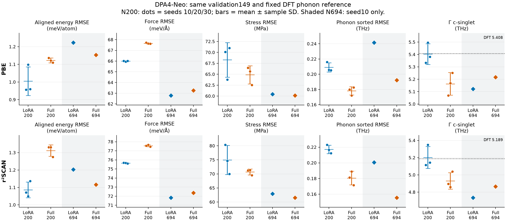
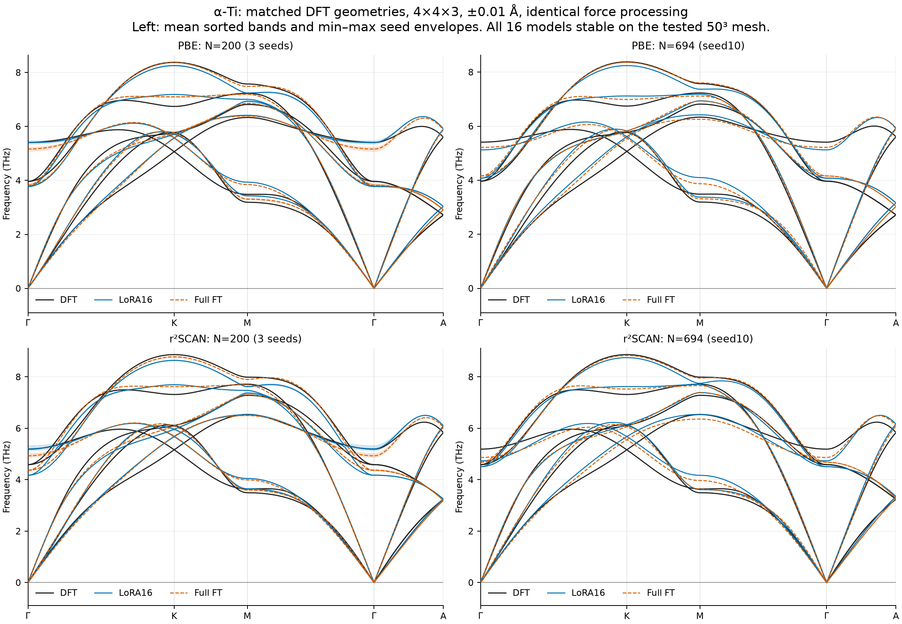

# DPA4: N200 по трём seeds и полный train694

Проверено 7 ноября 2026 года. **Все 16 моделей завершены**: 12 N200 (PBE/r²SCAN × LoRA16/full FT × seeds10/20/30) и 4 N694 (тот же набор методов/XC, seed10). Новые GPU arrays20988583 и20988587, CPU QC20988585/20988588 и сводки20988586/20988589 завершены с exit0. Очередь этих заданий пуста.

Собраны 2112 новых файлов с проверкой SHA256, включая 12 финальных merged weights. Вновь вычисленные локально метрики всех12 новых моделей совпали с кластерными. Проверены хеши final/native/export/QC и260 checkpoint-проверок, включая40 ранее завершённого seed10. Zero-step, frozen weights, маски, native/export и конечные разности E/F/virial — PASS. Все seeds включены; выбор лучшего seed или checkpoint не выполнялся.

## Validation и разброс обучения

В таблицах RMSE; для N200 показаны **среднее ± sample SD между тремя training seeds**, не standard error и не доверительный интервал по структурам. N694 имеет только seed10, поэтому его разброс не определён. Validation149 одна и та же у всех16 моделей, включает23 консервативные группы состава. Повторы seeds не превращают эти149 структур в447 независимых наблюдений.

E aligned — энергия после двух элементных сдвигов, подобранных исключительно на train соответствующего запуска. Это дополнительная gauge-коррекция для метрики; raw E приведена отдельно. Силы объединяются по атомам и компонентам, stress — по шести симметричным компонентам. Checkpoint фиксирован после50 nominal epochs:10000 шагов для N200 и34700 для N694.

| N | XC | Метод | E raw, meV/atom | E aligned, meV/atom | F, eV/Å | σ, GPa |
|---:|---|---|---:|---:|---:|---:|
| 200 | PBE | LoRA16 | 1.980 ± 0.240 | 1.005 ± 0.081 | 0.06599 ± 0.00004 | 0.06829 ± 0.00395 |
| 200 | PBE | Full FT | 1.358 ± 0.360 | 1.123 ± 0.013 | 0.06766 ± 0.00005 | 0.06487 ± 0.00208 |
| 200 | r2SCAN | LoRA16 | 2.357 ± 0.584 | 1.086 ± 0.045 | 0.07565 ± 0.00004 | 0.07498 ± 0.00518 |
| 200 | r2SCAN | Full FT | 1.909 ± 0.467 | 1.312 ± 0.032 | 0.07756 ± 0.00010 | 0.07071 ± 0.00105 |
| 694 | PBE | LoRA16 | 2.480 | 1.223 | 0.06279 | 0.06043 |
| 694 | PBE | Full FT | 1.224 | 1.153 | 0.06326 | 0.06014 |
| 694 | r2SCAN | LoRA16 | 1.550 | 1.204 | 0.07183 | 0.06292 |
| 694 | r2SCAN | Full FT | 1.248 | 1.116 | 0.07238 | 0.06152 |

**N200:** LoRA имеет меньшие aligned-E и F RMSE для каждого из трёх парных seeds обоих XC. Среднее преимущество по F ≈2.47% для PBE и2.46% для r²SCAN; оно заметно больше наблюдаемого seed-разброса. При этом средняя raw E ошибка меньше у full FT: утверждение об энергии зависит от явного train-only выравнивания. По stress full FT лучше в2/3 seeds PBE и3/3 seeds r²SCAN, но величина разницы меняется сильнее, чем разница F.

Парные разности Δ=LoRA−full при одинаковом seed; отрицательная RMSE-разность благоприятна LoRA:

| XC | Метрика | Средняя Δ ± SD | Диапазон Δ по seeds | Seeds с меньшей ошибкой LoRA / full |
|---|---|---:|---:|---:|
| PBE | E aligned, meV/atom | -0.1179 ± 0.0831 | [-0.1803; -0.0236] | 3 / 0 |
| PBE | F, eV/Å | -0.001670 ± 0.000050 | [-0.001705; -0.001613] | 3 / 0 |
| PBE | σ, GPa | 0.003420 ± 0.005177 | [-0.001869; 0.008476] | 1 / 2 |
| PBE | Spectral RMSE, THz | 0.0308 ± 0.0072 | [0.0226; 0.0362] | 0 / 3 |
| PBE | Γ singlet abs error, THz | -0.1821 ± 0.0721 | [-0.2644; -0.1299] | 3 / 0 |
| r2SCAN | E aligned, meV/atom | -0.2257 ± 0.0770 | [-0.2801; -0.1375] | 3 / 0 |
| r2SCAN | F, eV/Å | -0.001909 ± 0.000079 | [-0.002000; -0.001854] | 3 / 0 |
| r2SCAN | σ, GPa | 0.004272 ± 0.004386 | [0.000493; 0.009081] | 0 / 3 |
| r2SCAN | Spectral RMSE, THz | 0.0366 ± 0.0079 | [0.0276; 0.0416] | 0 / 3 |
| r2SCAN | Γ singlet abs error, THz | -0.1655 ± 0.0568 | [-0.2187; -0.1056] | 3 / 0 |

**N694, seed10:** full FT имеет меньшие точечные aligned-E/stress RMSE; LoRA сохраняет небольшое преимущество по F (≈0.74–0.75%). Парный bootstrap2000 повторов по23 целым validation-группам даёт интервалы ΔF: PBE[−0.000844;−0.000066]eV/Å, r²SCAN[−0.000991;−0.000058]eV/Å. Для ΔE aligned интервалы PBE[−0.0229;+0.1571] и r²SCAN[−0.0561;+0.2228]meV/atom включают0; stress-интервалы также включают0. Поэтому преимущество full FT по этим двум validation-метрикам пока точечное. Эти bootstrap-интервалы условны для seed10 и не заменяют недостающие training seeds N694.

Validation содержит133 liquid/relaxation,7 γ-TiAl,7 β-Ti/bcc и2 α-Ti/hcp; общее качество в основном отражает жидкостный пул. Метрики семейств, элементов, MAE, p95/p99/max и индивидуальные residuals сохранены в исходных metrics/per_structure файлах. Три training seeds недостаточны для общего заявления о превосходстве метода за пределами этого протокола.

## Фононы и идентификация мод

Одинаковые XC-specific фиксированные DFT-геометрии α-Ti, supercell4×4×3, смещения±0.01Å, масса47.867, central-pair/mean-drift/symfc/ASR. ML-релаксации нет. Spectral RMSE рассчитана на604 одинаковых q-точках пути Γ–K–M–Γ–A. Частотно упорядоченная ошибка отдельно сверена с eigenvector-overlap assignment и проекторами вырожденных подпространств; она не выдаётся за непрерывное отслеживание конкретной ветви.

DFT Γ doublet/singlet: **PBE3.964/5.408THz; r²SCAN4.587/5.189THz**.

| N | XC | Метод | Sorted RMSE, THz | Overlap-matched RMSE, THz | Γ doublet, THz | Γ c-singlet, THz | Средняя абсолютная ошибка синглета, THz |
|---:|---|---|---:|---:|---:|---:|---:|
| 200 | PBE | LoRA16 | 0.209 ± 0.006 | 0.216 ± 0.007 | 3.778 ± 0.022 | 5.403 ± 0.083 | 0.063 ± 0.032 |
| 200 | PBE | Full FT | 0.178 ± 0.005 | 0.184 ± 0.005 | 3.819 ± 0.063 | 5.163 ± 0.091 | 0.245 ± 0.091 |
| 200 | r2SCAN | LoRA16 | 0.217 ± 0.005 | 0.227 ± 0.006 | 4.176 ± 0.014 | 5.202 ± 0.127 | 0.093 ± 0.059 |
| 200 | r2SCAN | Full FT | 0.181 ± 0.009 | 0.187 ± 0.008 | 4.367 ± 0.036 | 4.931 ± 0.095 | 0.259 ± 0.095 |
| 694 | PBE | LoRA16 | 0.242 | 0.246 | 4.077 | 5.122 | 0.286 |
| 694 | PBE | Full FT | 0.192 | 0.197 | 4.157 | 5.216 | 0.192 |
| 694 | r2SCAN | LoRA16 | 0.201 | 0.206 | 4.508 | 4.735 | 0.454 |
| 694 | r2SCAN | Full FT | 0.156 | 0.162 | 4.680 | 4.866 | 0.323 |

На N200 **full FT лучше по общей spectral RMSE во всех трёх seeds обоих XC**, а LoRA лучше по абсолютной ошибке c-singlet во всех трёх. Для PBE средняя частота синглета LoRA5.403 близка кDFT5.408, но ошибка не равна0.005: средняя абсолютная ошибка отдельных seeds0.063THz. Для r²SCAN соответствующая абсолютная ошибка0.093THz. Усреднение частот может компенсировать ошибки разных знаков, поэтому оно не подменяет среднюю ошибку отдельных моделей.

При N694 full FT точнее по спектру и по синглету, LoRA — по doublet. Для r²SCAN синглет LoRA падает с5.115 (N200 seed10) до4.735THz, хотя spectral RMSE улучшается с0.223 до0.201THz. У full FT синглет меняется4.896→4.866THz, spectral RMSE0.181→0.156THz. Улучшение среднего спектра не означает улучшения каждой моды.

У **всех16 моделей** на mesh50³ нет частот ниже−0.001THz, уже на raw FC, а также после central/ASR. Отрицательные остатки порядка10⁻⁷THz считаются численным нулём. У исходной FM на этих ячейках были выраженные мнимые ветви; её spectral RMSE0.698(PBE) и1.010(r²SCAN). Ни один из новых результатов не доказывает долговременную или высокотемпературную MD-устойчивость.

| N | XC | Метод | Относит. D-matrix ошибка | Относит. FC ошибка | DOS L1, modes/atom | Ошибка Γ–A поперечной скорости, % |
|---:|---|---|---:|---:|---:|---:|
| 200 | PBE | LoRA16 | 0.0813 ± 0.0023 | 0.0627 ± 0.0004 | 0.4211 ± 0.0107 | 0.52 ± 0.46 |
| 200 | PBE | Full FT | 0.0657 ± 0.0015 | 0.0533 ± 0.0018 | 0.3982 ± 0.0474 | -5.55 ± 0.76 |
| 200 | r2SCAN | LoRA16 | 0.0824 ± 0.0020 | 0.0652 ± 0.0021 | 0.3351 ± 0.0220 | -13.05 ± 1.27 |
| 200 | r2SCAN | Full FT | 0.0609 ± 0.0015 | 0.0536 ± 0.0008 | 0.3449 ± 0.0183 | -16.86 ± 0.59 |
| 694 | PBE | LoRA16 | 0.0786 | 0.0578 | 0.5542 | 4.23 |
| 694 | PBE | Full FT | 0.0612 | 0.0478 | 0.3735 | -1.22 |
| 694 | r2SCAN | LoRA16 | 0.0669 | 0.0523 | 0.4256 | -10.28 |
| 694 | r2SCAN | Full FT | 0.0498 | 0.0420 | 0.2946 | -15.69 |

DOS посчитана с одинаковыми mesh50³, Gaussianσ=0.05THz и нормировкой3моды/атом; интегралы проверены. Акустические скорости сравнены на тех же малых q, с сохранённой проверкой q=0.0005/0.001/0.002/0.004. В частности, большая общая точность full FT не устраняет занижение поперечных скоростей r²SCAN вдоль c. Сходимость на малых q относится к фиксированным FC, а не к DFT cutoff/kmesh/supercell.

## Что изменило увеличение train

Сравнение ниже строго парное: **seed10 N694 против seed10 N200**, а не против среднего трёх seeds. Отрицательный процент означает уменьшение ошибки.

| XC | Метод | Δ E aligned | Δ F | Δ stress | Δ spectral RMSE |
|---|---|---:|---:|---:|---:|
| PBE | LoRA16 | +27.91% | -4.89% | -13.83% | +11.78% |
| PBE | Full FT | +1.48% | -6.59% | -9.53% | +6.87% |
| r2SCAN | LoRA16 | +12.31% | -5.09% | -21.67% | -9.98% |
| r2SCAN | Full FT | -16.14% | -6.67% | -13.65% | -14.23% |

Больше данных улучшает F/stress во всех четырёх контролях, но aligned E меняется неоднородно. Фононы PBE ухудшаются по sorted RMSE, r²SCAN улучшаются; синглет может ухудшиться при улучшении спектра. N694 использует3.47раза больше optimizer steps при тех же50эпохах, поэтому это практический контроль полного train с изменённым вычислительным бюджетом, а не изолированное влияние числа меток при фиксированных шагах. N694 использует694train+149development=843метки/XC; N200 —349.

## Стоимость, ограничения и дальнейшее решение

Двенадцать новых задач использовали **17.708 GPU·h**: N200 seeds20/30 —6.854, N694 —10.854. С учётом исходного seed10 все16моделей —20.461 GPU·h, включая экспорт/оценку в GPU-allocation. Это выше предварительных≈14GPU·h для продолжения; в отчёте используются фактические значения Slurm. Ранее сохранённая неудачная preflight-попытка01 добавила13GPU-секунд и0optimizer steps.

Все задачи использовали A100-PCIE-40GB. Peak allocated memory: LoRA≈3.56–3.57GiB, full≈3.81–3.82GiB. Обучаемых параметров325158 против1124686; у LoRA285696адаптерных и39462исходных. Существенного выигрыша LoRA по времени эти рабочие запуски не показывают; разные wall times не являются изолированным timing benchmark. Данные, preprocessing, masks и seed-потоки проверены независимо от времени.

Техническое сравнение N200 по трём seeds завершено и воспроизводит компромисс: LoRA — validation aligned E/F и c-singlet, full FT — спектр в целом. **Универсального победителя нет.** N694 full FT интересен как кандидат по спектру, но имеет один seed, а небольшие validation E/stress преимущества неубедительны по условному group-bootstrap. Для устойчивого выбора на полном train логично повторить N694 наseeds20/30; эти дополнительные обучения в данном статусном запросе не запускались. Переход к дорогой MD или автоматический выбор «лучшего» checkpoint не выполнен.

Test149 и архивный benchmark49 не использовались для настройки/выбора. Группы по nTi/nAl остаются консервативным заменителем утраченных liquid-родителей; гарантия условна на сохранение состава в MD+relaxation. Фононы — physical development, не blind test. Различия обучающих/phonon DFT-протоколов и недоказанная cutoff/kmesh/supercell convergence сохраняются. Новых DFT0.

## Каждый seed отдельно

| N | XC | Метод | Seed | E aligned | F, eV/Å | Stress, GPa | Spectral RMSE, THz | Γ singlet, THz |
|---:|---|---|---:|---:|---:|---:|---:|---:|
| 200 | PBE | Full FT | 10 | 1.1365 | 0.067722 | 0.066471 | 0.1799 | 5.0692 |
| 200 | PBE | Full FT | 20 | 1.1219 | 0.067632 | 0.065634 | 0.1721 | 5.1686 |
| 200 | PBE | Full FT | 30 | 1.1098 | 0.067627 | 0.062517 | 0.1827 | 5.2509 |
| 200 | PBE | LoRA16 | 10 | 0.9562 | 0.066017 | 0.070122 | 0.2161 | 5.3336 |
| 200 | PBE | LoRA16 | 20 | 1.0983 | 0.065939 | 0.063765 | 0.2058 | 5.4957 |
| 200 | PBE | LoRA16 | 30 | 0.9600 | 0.066014 | 0.070993 | 0.2053 | 5.3808 |
| 200 | r2SCAN | Full FT | 10 | 1.3312 | 0.077552 | 0.071250 | 0.1813 | 4.8960 |
| 200 | r2SCAN | Full FT | 20 | 1.3303 | 0.077657 | 0.071376 | 0.1890 | 4.8580 |
| 200 | r2SCAN | Full FT | 30 | 1.2746 | 0.077462 | 0.069496 | 0.1716 | 5.0383 |
| 200 | r2SCAN | LoRA16 | 10 | 1.0717 | 0.075680 | 0.080331 | 0.2229 | 5.1147 |
| 200 | r2SCAN | LoRA16 | 20 | 1.0503 | 0.075657 | 0.074618 | 0.2166 | 5.3486 |
| 200 | r2SCAN | LoRA16 | 30 | 1.1370 | 0.075608 | 0.069989 | 0.2123 | 5.1438 |
| 694 | PBE | Full FT | 10 | 1.1533 | 0.063260 | 0.060137 | 0.1922 | 5.2163 |
| 694 | PBE | LoRA16 | 10 | 1.2231 | 0.062789 | 0.060425 | 0.2415 | 5.1219 |
| 694 | r2SCAN | Full FT | 10 | 1.1163 | 0.072377 | 0.061525 | 0.1555 | 4.8661 |
| 694 | r2SCAN | LoRA16 | 10 | 1.2036 | 0.071830 | 0.062921 | 0.2007 | 4.7351 |

## Артефакты

- [Полное сравнение16моделей JSON](../runs/dpa4-replicates-full-20261106-02/comparison-20261107/comparison.json).
- [Условный group-bootstrap для каждого seed](../runs/dpa4-replicates-full-20261106-02/comparison-20261107/conditional-group-bootstrap.json).
- [Манифест собранных файлов, Slurm accounting и hashes весов](../runs/dpa4-replicates-full-20261106-02/collected/COLLECTION_MANIFEST.json).
- [Исходная автоматическая N200-сводка](../runs/dpa4-replicates-full-20261106-02/collected/aggregates/N200/summary.json) и [N694-сводка](../runs/dpa4-replicates-full-20261106-02/collected/aggregates/N694/summary.json).
- [PDF метрик](multiseed-fulltrain-20261107/metrics-seed-spread.pdf), [PDF спектров](multiseed-fulltrain-20261107/phonons-N200-N694.pdf), [DOS L1](multiseed-fulltrain-20261107/DOS-L1.json).

Новые final merged weights: `runs/dpa4-replicates-full-20261106-02/collected/training-plan01/cases/<case>/merged/10000.pt` или `34700.pt`. Native optimizer checkpoints и frozen exports остались на UMT; пути и SHA256 сохранены в манифесте. Предыдущие данные/отчёты/failed attempts не перезаписаны. Git repository остаётся unborn без author identity; источники и hashes программ сохранены вместе с результатами.
