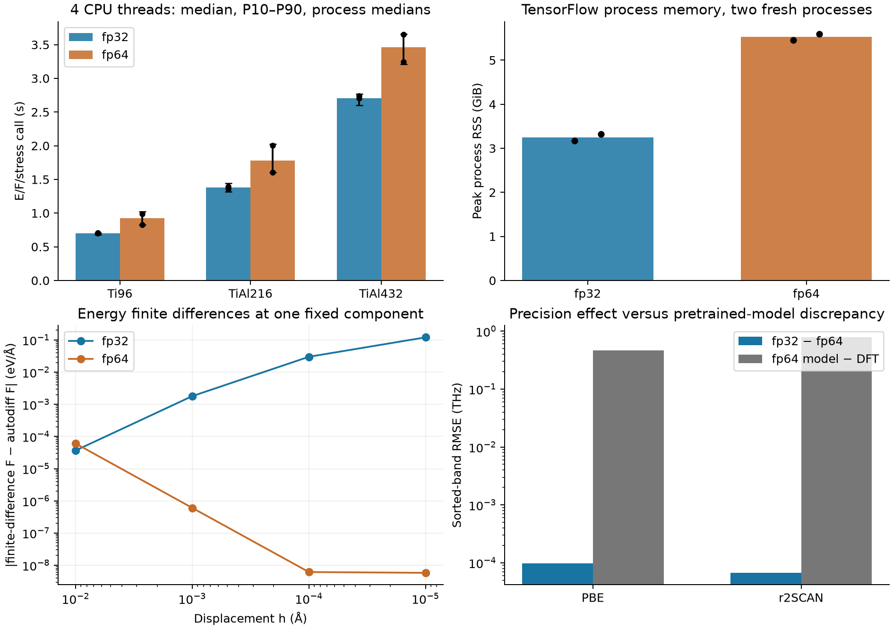

# GRACE: сравнение fp32 и fp64

Состояние на 2026-11-07T16:47:17.370485+00:00 UTC. GRACE training ещё не запущен; точность остаётся предварительным выбором.

## Что сравнивается

FP32 хранит число в 32 битах (около 7 значащих цифр), FP64 — в 64 битах (около 16). В данном GRACE fp32 означает параметры и часть вычислений нейросети в float32 при геометрии float64; FP64 использует двойную точность параметров. Численная точность влияет на округление и разности близких энергий/сил. Ошибка относительно DFT также зависит от самой модели и обучающих данных.

Официальная документация даёт ориентир около 2× ускорения и снижения памяти для fp32. Этот ориентир не заменяет измерения на выбранном backend, устройстве и размерах ячеек. [Документация GRACE](https://gracemaker.readthedocs.io/en/latest/gracemaker/foundation/).

Контролируемый эксперимент использует GRACE-2L-OMAT-medium-base: исходный fp64 checkpoint revision `4aff666029967745f7993f348eb87a804d625cff`, архив SHA-256 `763b7e5679c81ea82d39e595e701d0c9f6565064393f705cbe76663c9583d0aa`. FP32 checkpoint получен преобразованием тензоров этого источника в типы native fp32-модели. Все 44 model tensors проверены на точное равенство после cast. Обучение не выполнялось.

Официальный fp32-архив той же revision не загружен полностью из-за медленной передачи (~50 КБ/с); partial-файл сохранён и не используется. Преобразованный checkpoint явно отличается по происхождению от скачанного официального fp32-артефакта.

Первая попытка 20989425 остановилась до инференса: имена путей aliased TensorFlow objects в старом checkpoint отличаются от сериализации текущего backend. Исправление восстанавливает source через object graph, нормализует его текущим backend и затем выполняет cast. Исходные веса не изменены; неудачная попытка сохранена в grace-precision-20261107-01. Зависимые старые GPU-задачи 20989427/20989428 отменены, DPA4 jobs не изменялись.

## Протокол

- TensorPotential 0.6.1 / TensorFlow 2.20.0, native TPModel + ASE TPCalculator, diverse/segment engine, UQ и TF32 выключены.
- CPU: 4 потока, main compute JIT выключен; A100: main compute XLA включён. Сравнение точностей выполняется внутри одного устройства/режима, а не между разными backend.
- Четыре свежих процесса в порядке fp32/fp64/fp64/fp32. Холодный вызов и прогрев учитываются отдельно; ASE result cache принудительно обходится. Результаты синхронизируются переводом выходов TensorFlow в numpy.
- Ti96 и TiAl216/432; A100 дополнительно TiAl864. После прогрева — по 6 CPU или 30 GPU измерений на размер в каждом из двух процессов.
- 8 фиксированных N200-train геометрий × 2 XC, с исходными XC-specific координатами: pure Al/Ti/alloy probes и все четыре семейства. Это численный диагностический panel, не полный validation benchmark.
- Производные: силы при h=1e−2…1e−5 Å; гидростатический stress при strain=1e−3…1e−5. Фононы PBE/r²SCAN на одних DFT cells, ±0.01 Å, тот же central/ASR protocol и mesh 50³.
- Это TensorFlow/ASE latency, а не измерение LAMMPS/Kokkos MD throughput. Финальная стоимость MD требует соответствующего deployment backend.

CPU benchmark **20989429**, анализ **20989430**. A100 benchmark **20989431**, анализ **20989432**; GPU ждёт окончания N694 array 20989407.

## Измерения CPU

| Структура | fp32, ms | fp64, ms | Ускорение fp32 |
|---|---:|---:|---:|
| Ti96 | 703.65 | 923.94 | 1.31× |
| TiAl216 | 1379.55 | 1781.68 | 1.29× |
| TiAl432 | 2705.13 | 3461.78 | 1.28× |

Intel Xeon Gold 6254 (apollo30), выделены 4 CPU-потока. Медиана полного вызова E/F/stress, включая подготовку соседей. Распределения и отдельные process medians сохранены в summary.json; два процесса оценивают технический разброс, а не вариацию физических структур. fp64 показал заметный разброс между процессами; объединённые коэффициенты ускорения следует считать ориентировочными.

| Разность fp32−fp64 | RMSE | Максимум |
|---|---:|---:|
| E_meV_atom | 7.6263e-05 | 0.000161098 |
| F_eV_A | 2.81481e-07 | 1.32013e-06 |
| stress_GPa | 1.10326e-06 | 4.27912e-06 |

| XC | Phonon RMSE fp32−fp64, THz | Максимум, THz | fp32/DFT RMSE | fp64/DFT RMSE |
|---|---:|---:|---:|---:|
| PBE | 9.85689e-05 | 0.000324491 | 0.467044 | 0.467031 |
| r2SCAN | 6.71496e-05 | 0.000210843 | 0.781422 | 0.781405 |

| Precision | Память численных параметров, MiB | Peak process RSS по двум запускам, MiB |
|---|---:|---|
| fp32 | 83.03 | 3251.2, 3397.7 |
| fp64 | 166.05 | 5582.8, 5732.3 |

Пиковая память процесса включает TensorFlow, параметры, промежуточные тензоры и кэши графов; она не обязана уменьшаться ровно вдвое.

| h, Å | Force FD error fp32, eV/Å | Force FD error fp64, eV/Å |
|---|---:|---:|
| 1e-02 | 3.681e-05 | 6.05279e-05 |
| 1e-03 | 0.00179901 | 6.05214e-07 |
| 1e-04 | 0.0300299 | 6.14141e-09 |
| 1e-05 | 0.120629 | 5.79571e-09 |

Для малого h видна разница в устойчивости finite differences энергии: при h=1e−4 Å ошибка fp32 составляет 0.0300 eV/Å, fp64 — 6.14e−9 eV/Å. При этом сами силы autodiff совпадают гораздо лучше: максимальное различие по panel 1.32e−6 eV/Å. Поэтому fp64 сохраняет пользу для строгих derivative checks, даже когда fp32 достаточен для самих предсказаний сил.

Фононные различия fp32−fp64 малы по сравнению с исходной модельной ошибкой к DFT: RMSE около 1e−4 THz против 0.47/0.78 THz. На ASR mesh 50³ обе точности не дают мод ниже −0.001 THz. Длительная MD-стабильность здесь не проверялась.

Дополнительное наблюдение для подготовки FT: raw energy mismatch к r²SCAN на этом panel около 4.08 eV/atom, почти одинаковый в обеих точностях. Он требует аудита энергетических отсчётов и train-only per-element alignment на всём N200 до настройки GRACE FT; это не эффект fp32. Panel не используется для подгонки offsets.

CPU результаты позволяют оценить влияние округления на выбранных структурах. Скорость A100 пока не измерена; выбор production precision остаётся открытым до GPU benchmark. Возможная схема после проверки: fp32 для массового inference, fp64 для строгих derivative/phonon diagnostics. Перевод обученных fp32 весов в fp64 повышает точность арифметики, но не восстанавливает информацию, утраченную при fp32 training.

Новых DFT и training jobs нет; test 149 и архивные 49 в сравнении не использованы.
