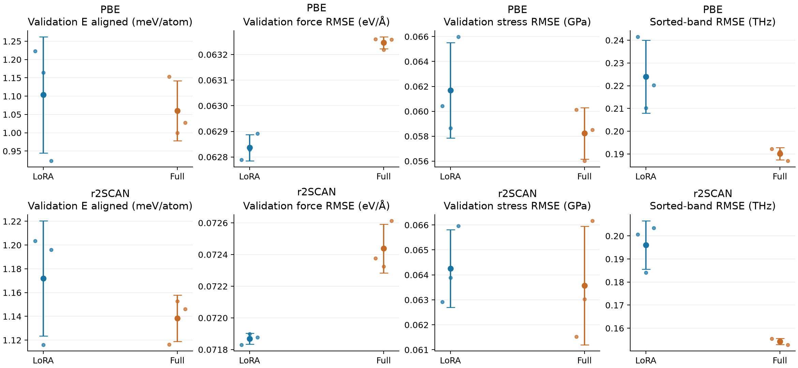
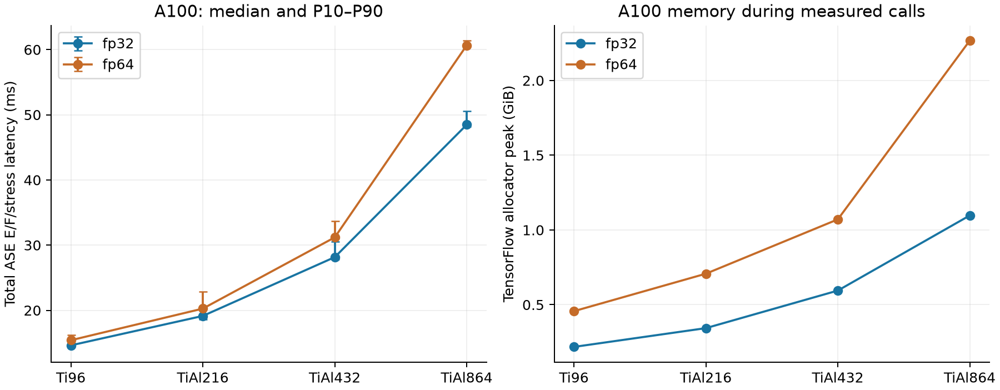

# N=694: три seeds; GRACE fp32/fp64 на A100

Собрано 2026-11-08T17:22:26.343274+00:00 UTC. Все задания завершены. N694: 12 моделей seeds10/20/30, 420 checkpoint checks, numerical/physical QC PASS. Все 12 validation-метрик воспроизведены локально из сохранённых предсказаний. Новые восемь повторов потребовали 21.760 GPU·ч.

## DPA4: validation и фононы

Среднее ± sample SD по трём training seeds. Validation149 общий; energy alignment подгоняется только на train каждой модели. Ошибки E/F/stress — RMSE. Фононы: одинаковые DFT cells, ±0.01Å, central/ASR protocol.

| XC | Метод | E aligned, meV/atom | F, eV/Å | Stress, GPa | Phonon, THz |
|---|---|---:|---:|---:|---:|
| PBE | lora16 | 1.103672 ± 0.158711 | 0.062836 ± 0.000051 | 0.061688 ± 0.003829 | 0.223990 ± 0.015990 |
| PBE | full | 1.060276 ± 0.081732 | 0.063246 ± 0.000024 | 0.058230 ± 0.002069 | 0.190084 ± 0.002722 |
| r2SCAN | lora16 | 1.171960 ± 0.048532 | 0.071869 ± 0.000035 | 0.064256 ± 0.001553 | 0.196080 ± 0.010521 |
| r2SCAN | full | 1.138393 ± 0.019418 | 0.072438 ± 0.000154 | 0.063572 ± 0.002372 | 0.154266 ± 0.001358 |

LoRA даёт меньший force RMSE во всех трёх seeds для обоих XC: среднее преимущество около 0.65% PBE и 0.79% r²SCAN. Full FT даёт меньшую ошибку всего фононного спектра во всех трёх seeds: улучшение относительно LoRA около 15.1% PBE и 21.3% r²SCAN; разброс full FT также меньше.

По aligned E full FT лучше в 2/3 seeds для каждого XC; средние преимущества 0.043 и 0.034 meV/atom сопоставимы с seed-разбросом, поэтому убедительного энергетического победителя нет. По stress full FT лучше в 3/3 PBE и 2/3 r²SCAN; среднее r²SCAN различие мало относительно разброса. Сохраняется компромисс между force fitting и глобальной гармоникой. При приоритете фононов full FT — предпочтительный DPA4-кандидат.

Raw E RMSE (без alignment), mean±SD: PBE LoRA2.278±0.653, full1.651±0.372; r²SCAN LoRA2.221±1.275, full1.676±0.395 meV/atom. Полные значения каждого seed, Γ doublet/singlet и парные разности сохранены в comparison.json. Проверки Γ-мод и акустики доступны в individual physical diagnostics; глобальный phonon RMSE не заменяет их.

Все 12 моделей не дают мнимых мод ниже−0.001 THz в сохранённой ASR mesh50³ диагностике. Три seeds оценивают техническую воспроизводимость, а не неопределённость по всем возможным train/test наборам.

## GRACE на A100

GPU benchmark20989431 и анализ 20989432 завершены (3м 42с и 20с). Native TensorPotential0.6.1 / TensorFlow2.20.0, TPModel/ASE diverse engine, main XLA включён, UQ/TF32 выключены. Два свежих процесса на точность, ABBA; 5 warmup и 30 измерений на размер в каждом процессе. Полный latency включает подготовку соседей и синхронизацию результатов. FP32 — контролируемое преобразование закреплённого fp64 checkpoint; все 44 тензора проверены после cast.

| Размер | fp32, ms | fp64, ms | Ускорение | Peak TF fp32, GiB | Peak TF fp64, GiB |
|---|---:|---:|---:|---:|---:|
| Ti96 | 14.62 | 15.41 | 1.054× | 0.218 | 0.457 |
| TiAl216 | 19.13 | 20.26 | 1.059× | 0.343 | 0.707 |
| TiAl432 | 28.16 | 31.19 | 1.108× | 0.595 | 1.071 |
| TiAl864 | 48.47 | 60.65 | 1.251× | 1.097 | 2.267 |

Peak относится к TensorFlow allocator в измеряемом интервале после сброса peak counters; включает живые параметры и кэши ранее пройденных размеров. Это не полный объём процесса из nvidia-smi. Память почти вдвое меньше у fp32, но ускорение полного ASE-вызова всего 1.05–1.25×. На 864 атомах model+sync занимает 23.23ms/fp32 против 35.50ms/fp64; подготовка соседей и прочие CPU-издержки уменьшают выигрыш полного вызова. Холодные вызовы с компиляцией 8–14с исключены из steady timings.

| Разность fp32−fp64 | RMSE | Максимум |
|---|---:|---:|
| E_meV_atom | 0.00014331 | 0.000202745 |
| F_eV_A | 2.7675e-07 | 1.32006e-06 |
| stress_GPa | 2.34573e-06 | 8.46326e-06 |

Проверены 16 диагностических train-структур (8 геометрий × 2 XC), без validation/test подбора. Ни один результат не получен повторным использованием ASE result cache.

| XC | Phonon fp32−fp64 RMSE, THz | Максимум, THz |
|---|---:|---:|
| PBE | 8.17522e-05 | 0.00018282 |
| r2SCAN | 8.09413e-05 | 0.000211228 |

## Дальнейший режим

Для массового inference — fp32: меньше память, умеренное ускорение, различия сил и фононов на проверенном panel малы. Для строгих finite-difference и эталонных фононных проверок — fp64. На A100 fp64 не оказался вдвое медленнее: при 216 атомах полный вызов дольше примерно на 6%, при 864 — на 25%. Это измерения TensorFlow/ASE; LAMMPS/Kokkos throughput и длинная MD ещё не проверены.

Точность обучения этим inference benchmark не установлена. Первый GRACE reference pilot разумно сохранить в fp64, затем проверить fp32 коротким matched optimizer/profile запуском перед расширением: текущий тест не содержит backprop и Adam state. Обязательны fresh optimizer, проверка frozen tensors, GRACE-specific B0/H0 и train-only energy-reference alignment (особенно r²SCAN). Новые обучения GRACE данным запросом не отправлялись.

Исходный и derived checkpoints сохранены. Test149 и архивные 49 не использовались в настройке. Все numerical значения и QC evidence: runs/dpa4-n694-seeds-20261107-01/comparison-20261108/comparison.json.
