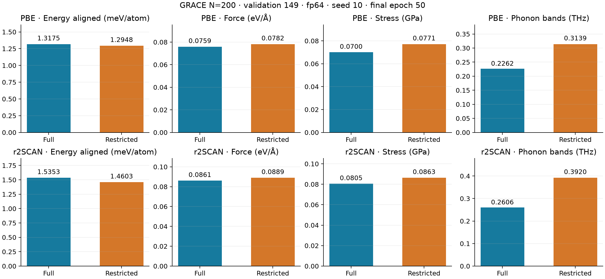
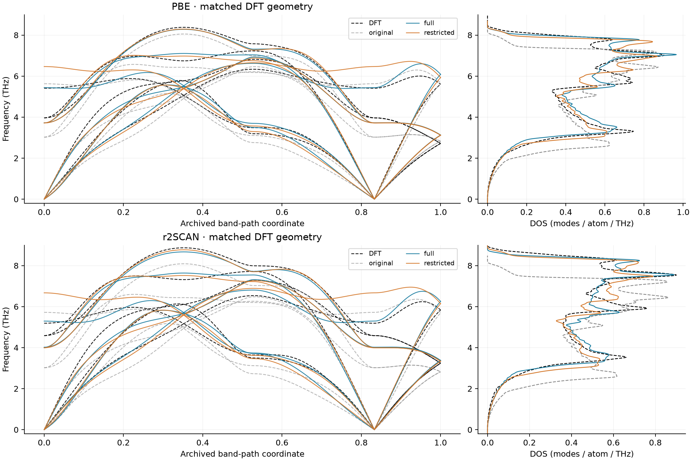

# GRACE N=200: завершённые full/restricted пилоты

Снимок: 2026-11-09T06:57:16.922230+00:00. Все четыре задачи 20990597_0–3 и фононы 20990598_0–3 COMPLETED, ExitCode 0:0. Проверки обучения, export/numerical QC и гармоник PASS. Для каждой модели выполнено 10000 шагов / 50 эпох, seed 10, fp64.

| XC | Модель | E raw, meV/atom | E aligned, meV/atom | F, eV/Å | Stress, GPa | Фононы, THz |
|---|---|---:|---:|---:|---:|---:|
| PBE | original | 4.9004 | 2.7374 | 0.082732 | 0.119736 | 0.467031 |
| PBE | full | 2.5596 | 1.3175 | 0.075899 | 0.069996 | 0.226194 |
| PBE | restricted | 1.4024 | 1.2948 | 0.078173 | 0.077110 | 0.313943 |
| r2SCAN | original | 4165.1218 | 20.6213 | 0.106100 | 0.871547 | 0.781405 |
| r2SCAN | full | 2.9798 | 1.5353 | 0.086085 | 0.080469 | 0.260594 |
| r2SCAN | restricted | 1.6083 | 1.4603 | 0.088937 | 0.086315 | 0.391991 |

Все значения — RMSE. Энергия: ошибка на атом с равным весом структур; F: компоненты с весом по числу атомов; stress: шесть компонент с равным весом структур. Исходная энергия original не калибрована; raw у FT уже включает исходное train-only выравнивание до обучения. E aligned дополнительно устраняет остаточный композиционный сдвиг по train200 финальной модели. Ни одна поправка не подгонялась по validation.

В этом seed full выигрывает по F, stress и общей ошибке фононных ветвей для обоих XC. Restricted немного лучше по E aligned и заметнее по raw E. Статистического вывода по seeds пока нет: выполнен только seed 10.
- PBE: full снижает F RMSE на 2.91%, stress на 9.23%, phonon RMSE на 27.95% относительно restricted.
- r2SCAN: full снижает F RMSE на 3.21%, stress на 6.77%, phonon RMSE на 33.52% относительно restricted.

## Оптические моды Γ

| XC | Модель | Дублет, THz | Синглет вдоль c, THz |
|---|---|---:|---:|
| PBE | DFT | 3.9641 | 5.4082 |
| PBE | original | 3.0250 | 5.6284 |
| PBE | full | 3.7200 | 5.4375 |
| PBE | restricted | 3.7160 | 6.4660 |
| r2SCAN | DFT | 4.5866 | 5.1893 |
| r2SCAN | original | 3.0213 | 5.7200 |
| r2SCAN | full | 4.0154 | 5.2936 |
| r2SCAN | restricted | 3.9930 | 6.6707 |

Restricted завышает Γ-синглет: ошибки около 1.06 THz (PBE) и 1.48 THz (r²SCAN). Full: около 0.029 и 0.104 THz соответственно. Дублеты обоих FT остаются ниже DFT, особенно для r²SCAN. У всех четырёх моделей нет частот ниже −0.001 THz на mesh 50³; численные отрицательные акустические значения порядка 10⁻⁷ THz не считаются нестабильностью.

Фононы: те же фиксированные XC-specific DFT-ячейки, ±0.01 Å, central forces, symfc/ASR, mesh 50³. Ошибка ветвей — по отсортированным частотам в 604 q-точках, без сопоставления eigenvectors ветвь-к-ветви. Это диагностическое сравнение на development-структурах; оно не подтверждает сходимость DFT или стабильность длинной MD.

## Проверки и ресурсы

Локально проверены SHA-256 всех 314 собранных файлов, заново рассчитаны validation/train метрики из по-структурных сумм ошибок, ошибки bands, DOS-нормировка и число мнимых мод. На UMT проверены текущие хеши четырёх финальных checkpoint и экспортов, а также 53 исходных файла. Подтверждены 44 проверки изменений параметров; frozen tensors не менялись. Full: 21764956 trainable, restricted: 21111690 (12 тензоров; около 97% полного числа).

Суммарное время четырёх GPU jobs (обучение + оценка/export) — 0.8158 GPU·ч. Отдельно:

| XC | FT | Job, min | Training loop, min | Peak TF allocator, GiB |
|---|---|---:|---:|---:|
| PBE | full | 12.73 | 10.37 | 2.500 |
| PBE | restricted | 11.58 | 9.29 | 1.965 |
| r2SCAN | full | 12.98 | 10.61 | 2.538 |
| r2SCAN | restricted | 11.65 | 9.33 | 1.965 |

Peak относится к TensorFlow allocator, а не всей памяти процесса. Сравнение времени предварительное: один запуск каждой конфигурации. Финальные бинарные модели остаются на UMT; локально собраны метрики, журналы, model.yaml, хеши и фононные массивы.

Выборка train200 и validation149 сверена с frozen split; test149 и архивные49 не использованы. Гарантия отсутствия общих родительских траекторий условна при утраченных liquid trajectories и опирается на документированную группировку. Для PBE происхождение исходного поля DFT energy остаётся ранее отмеченным ограничением; raw-аудит r²SCAN выполнен.

Следующий обоснованный шаг — повторы N=200 с seeds 20/30 для обоих методов и XC, прежде чем объявлять устойчивый выигрыш и переходить к контролю N=694. В этом шаге новые обучения не запускались.

Машиночитаемое сравнение: `runs/grace-n200-fp64-pilot-20261109-02/comparison-final/comparison.json`. Полный сбор: `collected-final/COLLECTION_SHA256.json`; remote provenance: `final-remote-verification.json`.
