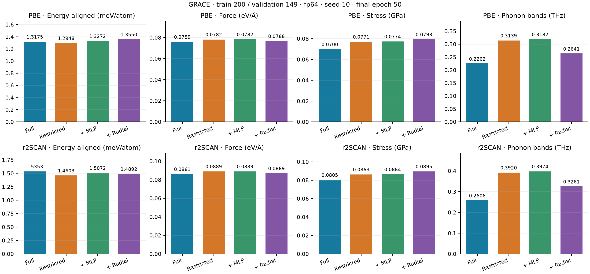
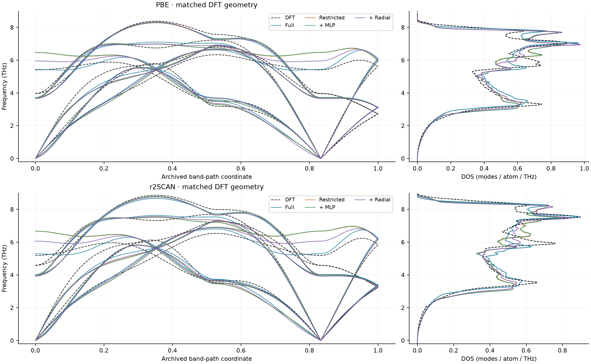

# GRACE N200: full, restricted, restricted + MLP, restricted + radial

Проверено 2026-11-09T12:40:13.765592+00:00. Повторы 20990790_1–3 COMPLETED, ExitCode 0:0; сохранён успешный PBE + MLP 20990675_0. Фононы 20990676_0–3 и сравнение 20990677 COMPLETED. Все восемь моделей: 10000 шагов / 50 эпох, fp64, seed 10. Optimizer, маски, numerical QC, export и фононы PASS.

| XC | FT | E raw, meV/atom | E aligned, meV/atom | F, eV/Å | Stress, GPa | Bands, THz |
|---|---|---:|---:|---:|---:|---:|
| PBE | full | 2.5596 | 1.3175 | 0.075899 | 0.069996 | 0.226194 |
| PBE | restricted | 1.4024 | 1.2948 | 0.078173 | 0.077110 | 0.313943 |
| PBE | restricted_mlp | 2.0766 | 1.3272 | 0.078218 | 0.077380 | 0.318192 |
| PBE | restricted_radial | 2.0201 | 1.3550 | 0.076584 | 0.079293 | 0.264114 |
| r2SCAN | full | 2.9798 | 1.5353 | 0.086085 | 0.080469 | 0.260594 |
| r2SCAN | restricted | 1.6083 | 1.4603 | 0.088937 | 0.086315 | 0.391991 |
| r2SCAN | restricted_mlp | 2.2779 | 1.5072 | 0.088948 | 0.086444 | 0.397403 |
| r2SCAN | restricted_radial | 2.3450 | 1.4892 | 0.086948 | 0.089502 | 0.326108 |

Все значения — RMSE. Energy: равный вес структур, на атом; F: все компоненты с весом по числу атомов; stress: шесть компонент с равным весом структур. Raw FT уже включает исходную train-only поправку до обучения; aligned дополнительно устраняет остаточный композиционный сдвиг финальной модели, оценённый строго по train200.

В seed10 добавление энергетической MLP не улучшает ни одну из четырёх метрик относительно restricted для обоих XC. Изменения сил и stress очень малы; без повторов нельзя отличить слабый эффект от разброса.

Размораживание радиальных сетей снижает F RMSE на 2.03% (PBE) / 2.24% (r²SCAN), ошибку фононов на 15.87% / 16.81%. Цена: aligned E хуже на 4.66% / 1.98%, stress хуже на 2.83% / 3.69%. Full остаётся лучшим по F, stress и общей ошибке фононов для обоих XC; исходный restricted — лучший по raw и aligned E.

## Оптические моды в Γ

| XC | FT | Дублет, THz | Синглет, THz | Ошибка синглета, THz |
|---|---|---:|---:|---:|
| PBE | DFT | 3.9641 | 5.4082 | — |
| PBE | full | 3.7200 | 5.4375 | 0.0293 |
| PBE | restricted | 3.7160 | 6.4660 | 1.0578 |
| PBE | restricted_mlp | 3.7155 | 6.4765 | 1.0683 |
| PBE | restricted_radial | 3.6592 | 5.9497 | 0.5415 |
| r2SCAN | DFT | 4.5866 | 5.1893 | — |
| r2SCAN | full | 4.0154 | 5.2936 | 0.1043 |
| r2SCAN | restricted | 3.9930 | 6.6707 | 1.4814 |
| r2SCAN | restricted_mlp | 3.9875 | 6.6804 | 1.4911 |
| r2SCAN | restricted_radial | 3.9284 | 6.0631 | 0.8738 |

Радиальные сети уменьшают завышение Γ-синглета: PBE 1.058 → 0.542 THz, r²SCAN 1.481 → 0.874 THz; full даёт 0.029 / 0.104 THz. MLP это отклонение не исправляет. Это согласуется с важной ролью радиального представления в наблюдаемой ошибке кривизны, но не доказывает единственный механизм её возникновения.

У всех восьми моделей нет мод ниже −0.001 THz на mesh50³. Сравнение на фиксированных XC-specific DFT-ячейках: central ±0.01 Å, symfc/ASR, 604 q-точки, шесть отсортированных частот в каждой точке; eigenvector tracking не выполнялся. DOS нормирована до трёх мод на атом. Это development-диагностика, не проверка сходимости DFT или длительной MD.

## Контроль эксперимента

Локально проверены SHA-256 637 файлов двух сборов; validation/train метрики независимо пересчитаны из по-структурных ошибок, фононы — из bands/mesh/DOS. Проверены восемь финальных checkpoint по remote provenance и 88 проверки параметров; frozen tensors не менялись. Первые пять batches совпадают между четырьмя масками внутри каждого XC, train200/validation149 сверены с frozen split. Test149 и архивные49 не использованы.

Restricted обучает I2/reducing_, rho/reducing_, I1/reducing_: 21111690 номинальных параметров. +MLP добавляет LinMLPOut2ScalarTarget_ (1088 параметров); +radial добавляет R_Linear_ и R1_Linear_ (33152). Full: 21764956. Номинальная доля restricted около 97% не отражает эффективную адаптацию двух элементов: базовые 12 тензоров имеют 89-element axis; Al/Ti-блоки содержат 474420 коэффициентов. Поэлементный аудит изменённых строк отдельно не выполнялся.

Все научные настройки совпадают с parent pilot: seed10, источник, train-only alignment, Adam, LR 1e-3→1e-4, batch1, loss и 50 эпох. После Disk quota exceeded три запуска начаты заново с исходных выровненных весов и нового Adam. Изменена только политика дисковой записи: отключены неиспользуемые best-validation checkpoint, сохранены регулярные optimizer checkpoint и финальные модели, добавлены quota guards. Выбор во всех моделях — фиксированная финальная эпоха50; best validation не загружается. История неудачных попыток сохранена в отчёте24.

Ограничения: один seed каждой конфигурации, поэтому статистической устойчивости различий пока нет. При утраченных liquid trajectories гарантия группового разделения условна и основана на документированном протоколе. Для PBE остаётся ранее отмеченное ограничение происхождения поля DFT energy; raw-аудит r²SCAN выполнен.

Рекомендация: проверить seeds20/30 для full, restricted и restricted + radial на обоих XC. +MLP пока имеет низкий приоритет. Затем контроль N694; на основании одного seed исключать варианты окончательно преждевременно. Новые обучения в этом шаге не запускались.

Машиночитаемый результат: `runs/grace-n200-mask-ablation-20261109-01/comparison-local/comparison.json`. Сбор: `collected-final/COLLECTION_SHA256.json`; актуальная проверка моделей: `final-remote-verification.json`.
