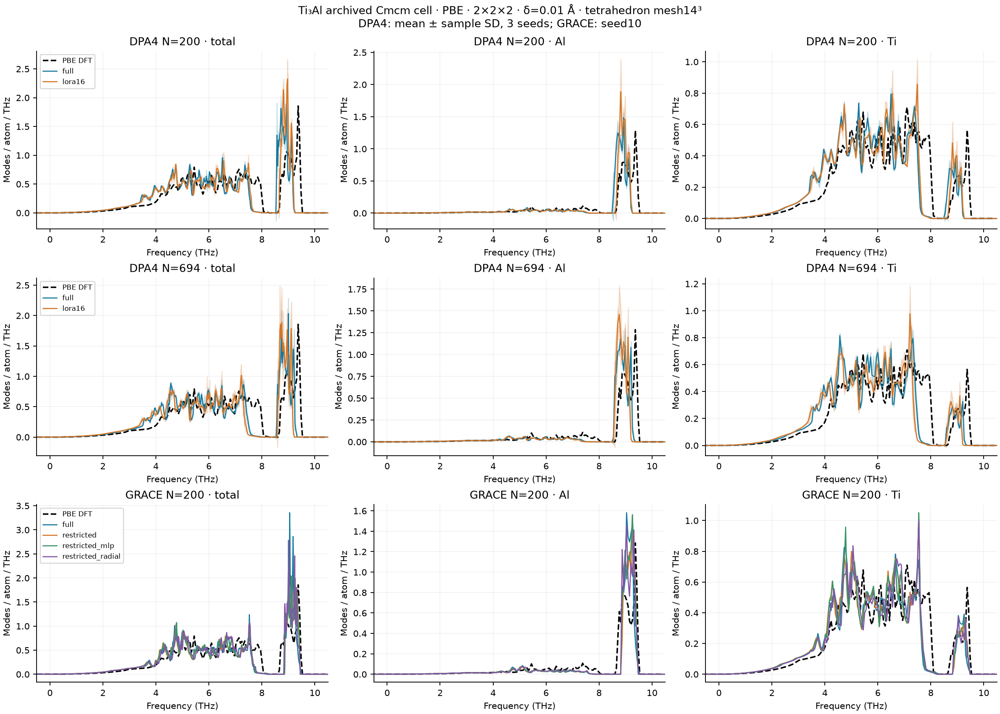

# Ti₃Al: проверка PBE-потенциалов по DFT-DOS

Рассчитаны все 16 завершённых PBE-моделей: DPA4 N200/N694 LoRA/full × seeds10/20/30 и GRACE N200 full/restricted/+MLP/+radial seed10. r²SCAN исключён из новых тестов по указанию пользователя. Новые обучения и DFT не запускались.

## Что воспроизводится

Фиксированная геометрия из архива Ti3Al_D019: 8 атомов в ячейке, суперячейка2×2×2 (64 атома), восемь сохранённых смещений ±0.01 Å, архивные массы Al26.981539/Ti47.867. Геометрия имеет Cmcm(63), поэтому имя каталога D019 не является подтверждением идеальной D0₁₉. Предварительная DFT-релаксация не восстановлена.

DFT-референс — сохранённые total_dos.dat и projected_dos.dat, тетраэдрический метод, фактическая сетка14³. VASP: PBE, Al/Ti_sv PAW, ENCUT480 eV, kmesh4³, EDIFF1e-8. Loose mesh.conf не использован. FORCE_SETS отсутствует локально, исходный каталог u3173 недоступен u3129; пользователь подтвердил отсутствие копии. Поэтому ошибок фононных ветвей относительно DFT здесь нет.

Силовые константы MLIP получены traditional solver без дополнительной ASR-правки; влияние ASR рассчитано отдельно. Использован Phonopy4.8.2, архив создан в2.40.0. Без исходных DFT-сил нельзя независимо воспроизвести исходную обработку force constants или доказать побитовое соответствие версий. Нормировка DOS — моды/(атом·THz), ожидаемый интеграл3. Архивная полная DOS имеет интеграл2.98745, сумма projected DOS — 3.00148; они сохранены как отдельные референсы без подгонки.

## Сравнение полной DOS

W₁ — расстояние Вассерштейна по частоте (THz), меньше лучше. Перед вычислением W₁ и L1 каждая DOS нормирована по своему интегралу; исходные ненормированные кривые и интегралы сохранены. Метрики используют расширенную сетку −5…20 THz, чтобы не потерять хвосты или отрицательные частоты. DPA4: среднее ± выборочное SD по трём seeds; GRACE: одно значение.

| Модель | W₁, THz | L1 нормированной DOS | min ν, THz | Мнимые моды, взвешенное число |
|---|---:|---:|---:|---:|
| DPA4 full N200 | 0.4016 ± 0.0032 | 0.5160 ± 0.0031 | 0.3045 ± 0.0037 | 0, 0, 0 |
| DPA4 lora16 N200 | 0.3565 ± 0.0111 | 0.4764 ± 0.0036 | 0.3223 ± 0.0090 | 0, 0, 0 |
| DPA4 full N694 | 0.4128 ± 0.0077 | 0.4995 ± 0.0089 | 0.3333 ± 0.0083 | 0, 0, 0 |
| DPA4 lora16 N694 | 0.4633 ± 0.0214 | 0.5584 ± 0.0168 | 0.2934 ± 0.0027 | 0, 0, 0 |
| GRACE full N200 | 0.2833 | 0.4479 | 0.3712 | 0 |
| GRACE restricted N200 | 0.2773 | 0.4017 | 0.3720 | 0 |
| GRACE restricted_mlp N200 | 0.2675 | 0.4007 | 0.3744 | 0 |
| GRACE restricted_radial N200 | 0.2317 | 0.4106 | 0.3773 | 0 |

GRACE restricted + radial имеет минимальный W₁ (0.2317 THz): на18.2% ниже full и на16.4% ниже restricted. По L1 лучший из GRACE — +MLP (0.4007), практически рядом с restricted (0.4017); +radial даёт0.4106. Следовательно, преимущество radial относится к частотному распределению по W₁, а не ко всем возможным мерам сходства формы DOS.

У DPA4 N200 LoRA лучше full по W₁ во всех трёх seeds. На N694 порядок меняется: full лучше LoRA во всех трёх seeds. При увеличении train LoRA ухудшается с0.3565 до0.4633 THz (+30.0%); для full изменение0.4016→0.4128 THz значительно меньше. Увеличение train не гарантирует улучшения этого свойства. Среди данных pipelines все четыре GRACE имеют меньший W₁, чем DPA4, но это не доказательство превосходства архитектуры: различаются pretraining и рецепты, GRACE имеет только один seed.

Вклады Al/Ti показаны в расчёте на один атом всей системы, поэтому их сумма равна полной projected DOS. На рисунке у всех моделей заметен сдвиг высокочастотной группы относительно DFT; более низкий W₁ не означает полного совпадения спектра. Отрицательные частоты не удалены из численных метрик; если они выходят за показанный диапазон рисунка, это видно из таблицы и сохранённых массивов.

## Численная чувствительность и остаточные силы

| Модель | Fmax, eV/Å | max stress, GPa | δ0.005 vs0.01, THz | δ0.02 vs0.01, THz | ASR change, THz | W₁ mesh20³, THz |
|---|---:|---:|---:|---:|---:|---:|
| DPA4 full N200 | 0.0781 ± 0.0135 | 0.4769 ± 0.0464 | 0.0003 ± 0.0000 | 0.0009 ± 0.0000 | 0.0051 ± 0.0005 | 0.4029 ± 0.0032 |
| DPA4 lora16 N200 | 0.0206 ± 0.0114 | 0.6102 ± 0.1104 | 0.0002 ± 0.0000 | 0.0009 ± 0.0000 | 0.0019 ± 0.0001 | 0.3546 ± 0.0111 |
| DPA4 full N694 | 0.0568 ± 0.0019 | 0.7016 ± 0.0574 | 0.0002 ± 0.0000 | 0.0009 ± 0.0000 | 0.0054 ± 0.0008 | 0.4133 ± 0.0061 |
| DPA4 lora16 N694 | 0.0062 ± 0.0076 | 0.6920 ± 0.0521 | 0.0003 ± 0.0000 | 0.0011 ± 0.0001 | 0.0051 ± 0.0011 | 0.4628 ± 0.0161 |
| GRACE full N200 | 0.1489 | 0.7198 | 0.0002 | 0.0007 | 0.0000 | 0.2860 |
| GRACE restricted N200 | 0.1044 | 0.6704 | 0.0002 | 0.0006 | 0.0000 | 0.2747 |
| GRACE restricted_mlp N200 | 0.0968 | 0.6517 | 0.0002 | 0.0006 | 0.0000 | 0.2667 |
| GRACE restricted_radial N200 | 0.1170 | 0.7582 | 0.0002 | 0.0007 | 0.0000 | 0.2311 |

Ошибки при изменении δ и ASR — RMSE по одним и тем же частотно отсортированным ветвям на архивном пути. Это численная чувствительность MLIP, не ошибка к DFT. Mesh20³ меняет только интегрирование MLIP-DOS; DFT остаётся на14³. Сходимость по размеру суперячейки не проверена. Остаточные силы/stress характеризуют MLIP в фиксированной архивной ячейке, не новую релаксацию. У GRACE Fmax0.097–0.149 eV/Å: ячейку нельзя считать равновесной для этих моделей, несмотря на более близкую DOS.

## Акустические моды Γ и ASR

Сетка14³ без Gamma-centering не содержит Γ. Поэтому отсутствие мнимых мод на ней не исключает отрицательных частот в Γ. У DPA4 raw минимум Γ составляет −0.055…−0.159 THz. После ASR акустические частоты порядка10⁻⁷ THz, и мод ниже −0.001 THz на проверенном пути нет. У GRACE raw Γ около−0.00015 THz. Raw результаты сохранены; ASR не заменяет их молча. Стабильность полного Brillouin zone или длительной MD этим тестом не доказана.

| Модель | min Γ raw, THz | min Γ ASR, THz | W₁ после ASR, THz |
|---|---:|---:|---:|
| DPA4 full N200 | -0.1312 ± 0.0117 | -6.71e-08 | 0.4028 ± 0.0030 |
| DPA4 lora16 N200 | -0.0625 ± 0.0063 | -1.40e-07 | 0.3561 ± 0.0106 |
| DPA4 full N694 | -0.1405 ± 0.0163 | -7.32e-08 | 0.4127 ± 0.0075 |
| DPA4 lora16 N694 | -0.1357 ± 0.0198 | -9.85e-09 | 0.4612 ± 0.0220 |
| GRACE full N200 | -0.0002 | 7.39e-08 | 0.2833 |
| GRACE restricted N200 | -0.0001 | -1.15e-07 | 0.2773 |
| GRACE restricted_mlp N200 | -0.0001 | 4.99e-08 | 0.2675 |
| GRACE restricted_radial N200 | -0.0001 | -8.71e-08 | 0.2317 |

Ранжирование средних W₁ после ASR сохраняется; меняются небольшие детали отдельных seeds. Проверки δ и q-mesh также не объясняют основные различия между группами.

## Provenance и область выводов

Хеши 293 собранных файлов проверены локально, DOS-метрики и число мнимых мод пересчитаны независимо, включая дополнительную ASR-DOS. Все16 моделей закреплены хешами; никаких изменений весов. Для сравнения с train/validation проверены 14 структуры того же состава Ti:Al=3:1 по периодическим парным распределениям и размеру примитивной ячейки. Минимальное относительное различие парных гистограмм0.976; ближайшие структуры имеют216 атомов в найденной примитивной ячейке. Подробности в prepared/overlap-screen.json. Это screening, а не доказательство независимости от деформированных эквивалентов. Пересечение с pretraining FM неизвестно; тест Ti₃Al обозначен development property diagnostic. Test149/архивные49 не оценивались.

Численные результаты: `runs/ti3al-pbe-phonons-20261109-02/comparison-local/comparison.json`. Полный сбор содержит силы для25 геометрий каждой модели, force constants, bands, DOS/PDOS, mesh14, проверки δ и ASR, хеши и Slurm-логи.
