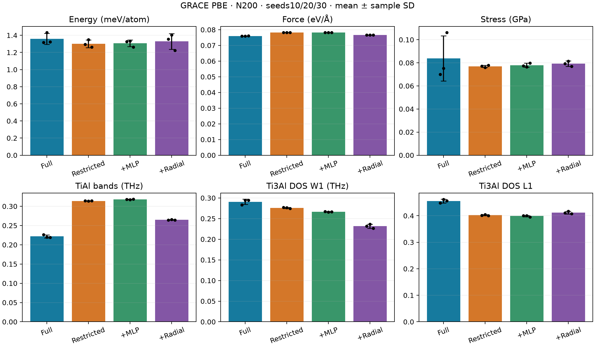
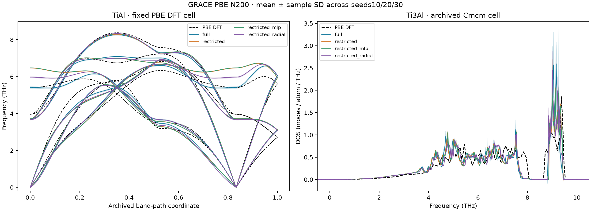

# GRACE N200 PBE: четыре маски, три seeds

Все восемь повторов 20991808_0–7 и сравнение 20991810 завершились COMPLETED / ExitCode0:0. Все12 моделей (включая seed10): 10000 шагов/50 эпох, fp64; optimizer/mask, numerical/export QC, фононы и provenance PASS. r²SCAN не включён.

Среднее ± выборочное SD по seeds10/20/30. Validation149 одинаков для всех моделей. E aligned — остаточная композиционная поправка, вычисленная только на train200. Фононы TiAl — RMSE отсортированных частот в604 q-точках; Ti₃Al — W₁ распределения частот DOS. Эти две фононные метрики не взаимозаменяемы.

| Маска | E aligned, meV/atom | F, eV/Å | Stress, GPa | TiAl bands, THz | Ti₃Al W₁, THz |
|---|---:|---:|---:|---:|---:|
| full | 1.35839 ± 0.06459 | 0.075948 ± 0.000072 | 0.08383 ± 0.01958 | 0.22179 ± 0.00387 | 0.29078 ± 0.00652 |
| restricted | 1.30231 ± 0.04510 | 0.078172 ± 0.000002 | 0.07694 ± 0.00096 | 0.31390 ± 0.00055 | 0.27593 ± 0.00155 |
| restricted_mlp | 1.30776 ± 0.03955 | 0.078221 ± 0.000002 | 0.07789 ± 0.00178 | 0.31805 ± 0.00063 | 0.26662 ± 0.00086 |
| restricted_radial | 1.32843 ± 0.09303 | 0.076609 ± 0.000021 | 0.07925 ± 0.00230 | 0.26468 ± 0.00079 | 0.23170 ± 0.00508 |

## Что устойчиво по seeds

- Full имеет наименьшую F RMSE и ошибку TiAl bands в каждом из трёх seeds. Относительно restricted средний выигрыш около2.85% по F и29.35% по TiAl bands.
- Restricted + radial имеет наименьший Ti₃Al W₁ во всех трёх seeds: в среднем на20.32% ниже full и на16.03% ниже restricted. Относительно full F RMSE выше лишь на0.87%, но ошибка TiAl bands выше на19.34%.
- Restricted имеет наименьшую среднюю aligned E; он лучше full в3/3 seeds, но различия между четырьмя масками малы и зависят от seed. Radial seed30 даёт минимальную E среди всех отдельных запусков; это не основание выбирать seed по удачному результату.
- +MLP улучшает Ti₃Al W₁ и L1 относительно restricted в3/3 seeds, но ухудшает F и TiAl bands в3/3. Его выигрыш локален для этого свойства, а не универсален.

## Энергия, Γ-мода и форма DOS

| Маска | E raw, meV/atom | Ошибка Γ-синглета TiAl, THz | Ti₃Al L1 | Ti₃Al W₁ после ASR, THz |
|---|---:|---:|---:|---:|
| full | 2.03082 ± 0.55412 | 0.03742 ± 0.00705 | 0.45560 ± 0.00721 | 0.29078 ± 0.00651 |
| restricted | 1.41445 ± 0.01146 | 1.06013 ± 0.00426 | 0.40252 ± 0.00217 | 0.27593 ± 0.00154 |
| restricted_mlp | 1.83582 ± 0.40337 | 1.06897 ± 0.00185 | 0.39883 ± 0.00285 | 0.26662 ± 0.00086 |
| restricted_radial | 1.91114 ± 0.48396 | 0.56403 ± 0.03036 | 0.41172 ± 0.00509 | 0.23171 ± 0.00509 |

По L1 формы DOS лучший результат у +MLP, а не у radial. W₁ и L1 отражают разные аспекты спектра; единой победившей маски по всем метрикам нет. ASR практически не меняет W₁ GRACE и его ранжирование.

## Stress full: существенный разброс

Full stress RMSE по seeds10/20/30: 0.07000 / 0.07525 / 0.10623 GPa. Поэтому его среднее0.08383±0.01958 выше, чем у restricted0.07694±0.00096. Full лучше restricted в seeds10/20, но хуже в seed30; прежний вывод о преимуществе full по stress, основанный на seed10, не устойчив.

Seed30 не исключён. Его численные, export и optimizer-проверки PASS; локальный пересчёт подтверждает ошибку. Самая большая отдельная validation-структура даёт лишь3.79% суммы квадратов stress-ошибок: результат не определяется единственным кадром. Причина повышенной чувствительности stress к seed отдельно не установлена.

## Проверки и ограничения

Проверены SHA-256 611 собранных файлов и текущие хеши8 новых финальных checkpoint, экспортов и сжатых Adam archives. Локально независимо пересчитаны validation-метрики, TiAl RMSE, Ti₃Al W₁/L1, ASR W₁, число мнимых мод и mean/SD. Проверены 132 записей контроля параметров; frozen tensors не менялись. Первые пять batches совпадают между масками одного seed; новые seeds20/30 различаются.

У всех12 моделей нет мод ниже−0.001THz на TiAl ASR mesh50³, Ti₃Al raw mesh14³ и проверенном Ti₃Al пути после ASR. Это не доказательство стабильности во всей зоне Бриллюэна или длительной MD. Ti₃Al — фиксированная архивная Cmcm-ячейка с неизвестной сходимостью исходной релаксации; DFT FORCE_SETS недоступен, поэтому DFT-ошибка ветвей Ti₃Al не заявляется. Три seeds оценивают вариацию обучения при одном разбиении, а не полную неопределённость.

Test149 и архивные49 не использованы. Гарантия группового разделения жидкостных родителей остаётся условной при утраченных траекториях; пересечение с FM pretraining неизвестно. Для PBE остаётся ранее отмеченное ограничение происхождения исходного DFT energy field.

Следующий приоритет: PBE GRACE full и restricted + radial на N694 по трём seeds. Restricted оставить контрольной точкой по энергии/stress; +MLP сохраняет интерес для формы Ti₃Al DOS. N694 не должен считаться автоматически лучше N200: обе фазы и validation проверяются заново. Новые обучения в этом шаге не запускались.

Машиночитаемые результаты: `runs/grace-pbe-seeds-20261110-01/comparison-local/comparison.json`; парные разности относительно full сохранены в paired_minus_full.
