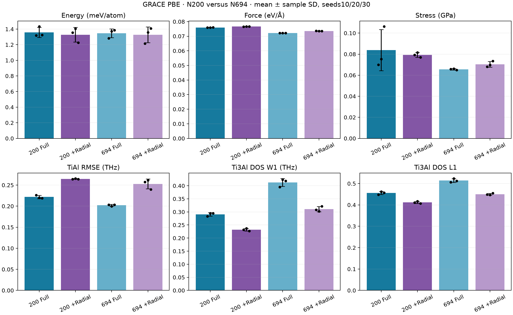
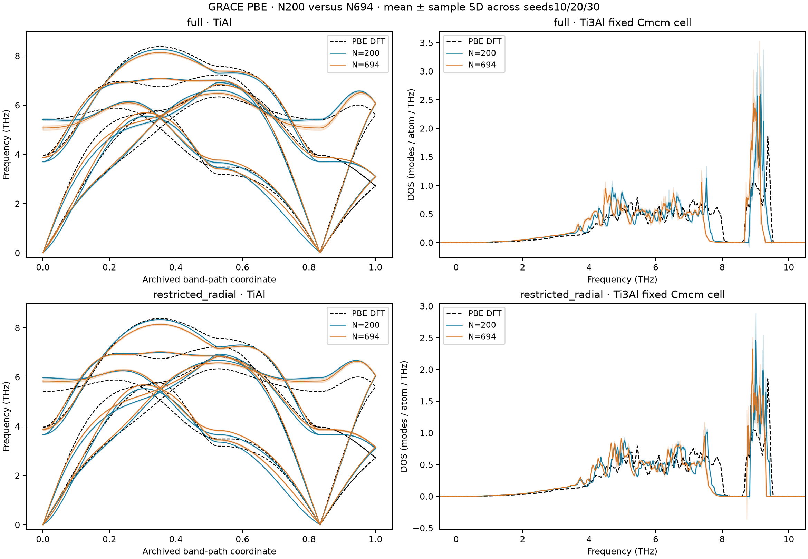

# GRACE PBE: N694 против N200

Все шесть обучений20991849_0–5 и сравнение20991850 завершены COMPLETED / ExitCode0:0. Production вместе с оценкой и экспортом занял3.0625 A100 GPU-hours; CPU-постобработка84s. Optimizer gate, numerical/export QC и проверка frozen tensors пройдены. Старые ошибки20991836/20991837 относятся к восстановленной первой попытке smoke; production не падал.

Все12 моделей проверены. Среднее ± выборочное SD по seeds10/20/30; меньше — лучше. Validation149 общий, выравнивание энергии только по train соответствующего N. TiAl RMSE относится к отсортированным ветвям, Ti₃Al W₁ — к распределению частот DOS.

| N | Маска | E, meV/атом | F, eV/Å | Stress, GPa | TiAl RMSE, THz | Ti₃Al W₁, THz | Ti₃Al L1 |
|---:|---|---:|---:|---:|---:|---:|---:|
| 200 | full | 1.358389 ± 0.064586 | 0.075948 ± 0.000072 | 0.083826 ± 0.019578 | 0.221787 ± 0.003868 | 0.290783 ± 0.006515 | 0.455597 ± 0.007212 |
| 200 | restricted_radial | 1.328433 ± 0.093030 | 0.076609 ± 0.000021 | 0.079248 ± 0.002303 | 0.264684 ± 0.000786 | 0.231697 ± 0.005080 | 0.411723 ± 0.005088 |
| 694 | full | 1.346458 ± 0.057131 | 0.072158 ± 0.000028 | 0.065649 ± 0.000655 | 0.202214 ± 0.002085 | 0.412411 ± 0.015129 | 0.514136 ± 0.008600 |
| 694 | restricted_radial | 1.327016 ± 0.100705 | 0.073594 ± 0.000006 | 0.070370 ± 0.002741 | 0.252850 ± 0.011605 | 0.310655 ± 0.010002 | 0.450258 ± 0.003890 |

## Выводы по трём seeds

При N694 обе маски улучшают F, stress и общий TiAl band RMSE во всех3 seeds, одновременно ухудшая Ti₃Al W₁ и L1 во всех3 seeds. Это устойчивое различие свойств при данном разбиении; увеличение train не даёт универсального улучшения.

- Full N694 против N200: F −4.99%, stress −21.68%, TiAl RMSE −8.82%; Ti₃Al W₁ +41.83%, L1 +12.85%. Средняя aligned E меняется лишь на−0.88%, знак изменения зависит от seed.
- Radial N694 против N200: F −3.93%, stress −11.20%, TiAl RMSE −4.47%; Ti₃Al W₁ +34.08%, L1 +9.36%. Средняя aligned E практически не меняется (−0.11%).
- Внутри N694 full лучше radial по F, stress и общему TiAl RMSE во всех3 seeds; средний выигрыш1.95%,6.71% и20.03%. Radial лучше по Ti₃Al W₁ и L1 во всех3 seeds; W₁ ниже на24.67%. Различие средней энергии небольшое относительно seed-разброса.
- Из этих четырёх сочетаний full N694 — основной кандидат по validation F/stress и общей дисперсии TiAl; radial N200 остаётся лучшим по обеим метрикам DOS Ti₃Al. Единой лучшей модели по всем свойствам нет.

У full большой stress-разброс N200 исчезает в этой серии N694:0.06569/0.06628/0.06498GPa для seeds10/20/30. Это наблюдение по трём seeds, а не гарантия отсутствия неустойчивых запусков.

Общий TiAl RMSE скрывает локальное ухудшение: ошибка Γ-синглета у full растёт с0.03742±0.00705 до0.33545±0.09277THz, во всех3 seeds. У radial она уменьшается с0.56403±0.03036 до0.43090±0.06516THz. Поэтому улучшение интегрального RMSE не означает улучшения каждой моды.

## Дополнительные метрики

| N | Маска | Raw E, meV/атом | Ошибка Γ-синглета, THz | Ti₃Al W₁ после ASR, THz |
|---:|---|---:|---:|---:|
| 200 | full | 2.030819 ± 0.554124 | 0.037421 ± 0.007047 | 0.290778 ± 0.006511 |
| 200 | restricted_radial | 1.911137 ± 0.483958 | 0.564032 ± 0.030360 | 0.231705 ± 0.005086 |
| 694 | full | 2.357510 ± 1.309030 | 0.335451 ± 0.092774 | 0.412414 ± 0.015133 |
| 694 | restricted_radial | 1.736652 ± 0.298652 | 0.430903 ± 0.065157 | 0.310656 ± 0.009990 |

Raw E у full N694 имеет большой seed-разброс; выравнивание удаляет композиционный сдвиг, но не улучшает силы или stress. ASR практически не меняет Ti₃Al W₁ и его ранжирование.

## Парные изменения N694 − N200

Отрицательное изменение означает улучшение. Порядок seeds:10/20/30.

### full

- E_aligned_RMSE_meV_atom: -0.036476, -0.060966, +0.061649
- F_RMSE_eV_A: -0.003713, -0.003757, -0.003899
- stress_RMSE_GPa: -0.004307, -0.008971, -0.041253
- TiAl_band_RMSE_THz: -0.022959, -0.020399, -0.015361
- Ti3Al_DOS_W1_THz: +0.111876, +0.128908, +0.124101
- Ti3Al_DOS_L1: +0.058501, +0.061223, +0.055892

### restricted_radial

- E_aligned_RMSE_meV_atom: -0.140764, -0.046505, +0.183017
- F_RMSE_eV_A: -0.002982, -0.003031, -0.003030
- stress_RMSE_GPa: -0.011314, -0.011759, -0.003562
- TiAl_band_RMSE_THz: -0.006704, -0.004098, -0.024699
- Ti3Al_DOS_W1_THz: +0.076345, +0.065438, +0.095092
- Ti3Al_DOS_L1: +0.038261, +0.029992, +0.047353

## Проверки и ограничения

50 эпох в обоих случаях:10000 updates для N200 и34700 для N694; вычислительный бюджет различается. Нельзя приписывать изменение только размеру данных отдельно от числа обновлений. SD характеризует только seed-разброс одного разбиения. Test149 и архивные49 не использованы, r²SCAN не включён.

Ti₃Al: фиксированная архивная Cmcm-ячейка, DFT FORCE_SETS недоступен, поэтому сравнивается DOS. У всех12 моделей нет мод ниже−0.001THz на TiAl ASR mesh50³, Ti₃Al raw mesh14³ и проверенном Ti₃Al пути после ASR. Это не доказывает стабильность всей зоны Бриллюэна или длительной MD. Исходная сходимость DFT-релаксации Ti₃Al неизвестна.

Условность реконструкции жидкост
ных родителей при утраченных траекториях и неопределённость пересечения с FM pretraining сохраняются. Происхождение PBE DFT energy field остаётся ранее отмеченным ограничением.

Проверены SHA-256 644 собранных файлов,6 текущих финальных checkpoint/экспортов/Adam archives и 282 записей контроля параметров. Validation, TiAl RMSE, Ti₃Al W₁/L1/ASR, числа мнимых мод, средние, SD и парные изменения пересчитаны локально.

Следующий приоритет: сохранить full N694 и radial N200 как основные контрастные модели; проверить покрытие Ti₃Al-состояний разрешённым train и отделить влияние числа updates контрольным опытом с одинаковым бюджетом. Новые обучения в этом шаге не запускались.
